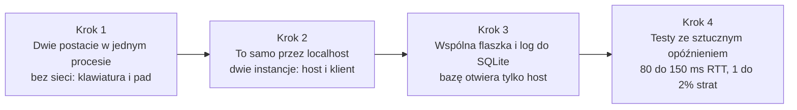
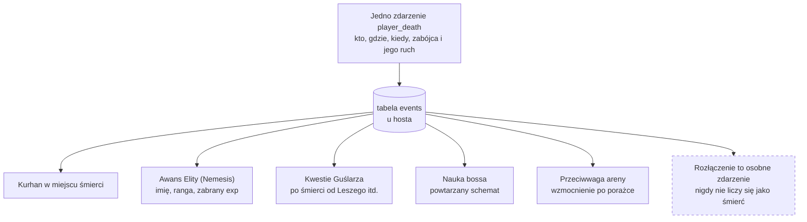
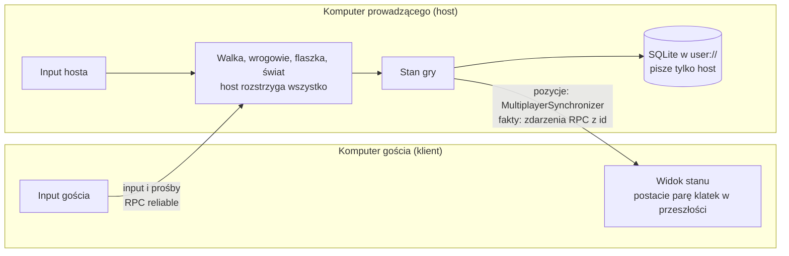
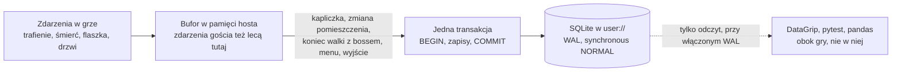

# ⚔️ Projekt KryLex - Game Design Document

Mroczna gra akcji/RPG 2D (side-scroller) w stylistyce pixel art, oparta na słowiańskiej mitologii, nastawiona na ścisłą kooperację dwóch graczy online i świat, który pamięta ich czyny.

> **Status dokumentu:** wersja prototypowa (październik 2026). Opisuje zakres prototypu testowego oraz kierunki rozwoju pełnej gry. Pozycje oznaczone `[DO UZUPEŁNIENIA]` zebrane są w sekcji 7.

---

## 📑 Spis Treści
1. [Organizacja i Założenia](#1-organizacja-i-założenia)
2. [Świat, Eksploracja i NPC](#2-świat-eksploracja-i-npc)
3. [Klasy, Rozwój i Ekwipunek](#3-klasy-rozwój-i-ekwipunek)
4. [Walka, Bossowie i Przeciwnicy](#4-walka-bossowie-i-przeciwnicy)
5. [Mechaniki Kooperacji (Online)](#5-mechaniki-kooperacji-online)
6. [Technika: Sieć, Baza Danych i Testy](#6-technika-sieć-baza-danych-i-testy)
7. [Lista Otwartych Punktów](#7-lista-otwartych-punktów)

---

## 1. Organizacja i Założenia

### 🎯 Pitch
Mroczna, pixel-artowa gra akcji/RPG w świecie słowiańskiej mitologii, w której dwoje graczy dzieli jedną flaszkę leczenia, a świat zapamiętuje każdą ich śmierć i każde zwycięstwo.

### 🏛️ Filary Projektu
Każda nowa mechanika musi wspierać przynajmniej jeden filar. Jeśli nie wspiera żadnego – nie wchodzi.
1. **Współzależność** – nic ważnego nie da się zrobić w pełni samemu. Gracze potrzebują siebie nawzajem do leczenia, walki i eksploracji.
2. **Świat pamięta** – akcje graczy mają widoczne, trwałe konsekwencje (wrogowie, NPC, otoczenie).
3. **Mroczna słowiańszczyzna** – świat, wrogowie i NPC czerpią z mitologii i są ponure; mitologia to źródło mechanik, nie tylko dekoracja. Bohaterowie są z innych czasów i mogą być barwniejsi – kontrast między nimi a światem jest zamierzony.

### 📐 Parametry Główne
- **Gatunek:** Action RPG / metroidvania 2D, kooperacja online dla 2 graczy.
- **Perspektywa:** Side-scroller (widok z boku).
- **Status projektu:** Prototyp testowy. Celem jest sprawdzenie, czy kluczowe mechaniki (co-op online, wspólna flaszka, świat sterowany bazą) są wykonalne i dają frajdę. Decyzja o pełnej kampanii zapada dopiero po ukończeniu prototypu.
- **Czas gry prototypu:** ok. 20–40 minut, jeden zamknięty obszar.
- **Stylistyka:** Pixel art, mroczny, słowiański klimat (w prototypie: grafika zastępcza).

### 🛠️ Decyzje Techniczne
| Obszar | Decyzja | Uzasadnienie |
|---|---|---|
| Silnik | **Godot 4.7.2-stable**, build standardowy, ta sama wersja u obojga | Darmowy, silne 2D, wbudowany high-level multiplayer (ENet / RPC). |
| Model sieci | **Host-authoritative P2P** | Jeden gracz hostuje i jest źródłem prawdy, drugi jest klientem. Brak kosztów serwera. |
| Baza danych | **SQLite przy hoście** | Stan świata żyje w sesji hosta i jest replikowany do klienta. Baza jest *per sesja*, nie globalna. |
| Język | **GDScript z typami** | Jeden język u obojga, bez .NET SDK. Typy wszędzie, a ostrzeżenia o ich braku ustawione na błąd. |
| Kontrola wersji | Git + **GitHub** ([KrystianRodziewicz/KryLex](https://github.com/KrystianRodziewicz/KryLex)) | Git LFS dla grafik i dźwięków. |

> **Konsekwencja modelu sieci:** wszystko, co wpływa na stan gry (AI, fizyka otoczenia, drop, baza SQL), liczy się wyłącznie na hoście. Klient wysyła tylko input i otrzymuje stan. Mechaniki wymagające precyzyjnego timingu po stronie klienta (parowanie, uniki, Atak Zgrany) muszą uwzględniać kompensację opóźnień.

> **Ustalone:** GDScript z typami (brak typu to błąd kompilacji), Godot 4.7.2-stable w standardowym buildzie u obojga, aktualizacja silnika tylko razem i bez bet. O trafieniach, parowaniach i unikach rozstrzyga host, czyli prowadzący gracz. Uzasadnienie i plan B: [`docs/technika.md`](docs/technika.md#język-i-narzędzia).

### 👥 Zespół i Role
- **Krystian – Backend / Netcode:** architektura sieciowa, synchronizacja stanu, SQLite, system zapisu, narzędzia deweloperskie.
- **Alex – Design / Mechaniki:** game design, balans, projektowanie poziomów, AI, walka, dokumentacja.
- **Wspólne:** oboje testują grę w co-opie minimum raz w tygodniu.

### 🎯 Zakres Prototypu

**W zakresie:**
- 1 zamknięty obszar (fragment jednego bioma), ok. 20–40 minut rozgrywki.
- 2 klasy (uzupełniające się), 1 Ślub na klasę + 1 Ślub wspólny.
- 1 boss z pełnymi mechanikami, 3–4 typy zwykłych mobów, 1 elita.
- Działający co-op online z wspólną flaszką i podstawowymi pingami.
- Logowanie akcji do SQLite + **jedna** prosta reakcja świata na dane z bazy (dowód koncepcji „świat pamięta").

**Poza zakresem prototypu (kandydaci do pełnej wersji):**
- Pozostałe biomy, klasy i pula Ślubów.
- System Nemesis, adaptacyjni bossowie, pamięć AI.
- Proceduralni NPC.
- Niszczalne otoczenie, mechanika latarni.
- Tryb solo, więcej niż 2 graczy, PvP, cross-play, migracja hosta.
- **Grafika i dźwięk** – prototyp używa assetów zastępczych (placeholder / darmowe paczki). Decyzja o docelowej oprawie i tym, kto ją wykona, zapada po prototypie.

**Kryterium sukcesu prototypu:**
Dwoje graczy może przejść obszar od początku do pokonania bossa w sesji online bez desynchronizacji, a wspólna flaszka wymusza komunikację zamiast ją irytować.

### 🗓️ Kamienie Milowe
| Etap | Cel | Termin |
|---|---|---|
| M0 – Prototyp sieci | Dwie postacie biegają po jednej planszy online, wspólna flaszka działa, zapis do SQLite. | bez terminu |
| M1 – Prototyp grywalny | Pełny zakres opisany wyżej, od startu do bossa. | bez terminu |
| Decyzja | Czy robimy pełną grę? Jeśli tak – nowy plan i aktualizacja tego dokumentu. | po M1 |

> **Ustalone:** terminów nie wyznaczamy. Robimy to po godzinach i bez pośpiechu, a etap jest gotowy, gdy spełnia swój cel z tabeli, nie gdy mija data. Kolejność etapów zostaje.

> **Propozycja:** kolejność prac w M0. Szczegóły każdego kroku: [`docs/technika.md`](docs/technika.md#kolejność-prac-w-m0).

### 🔄 Przepływ Pracy (Git Workflow)
1. **Branch `main`** – zawsze stabilna, działająca gra. Nie pracujemy na nim bezpośrednio.
2. Każda nowa rzecz ma **własny branch** z prefiksem: `feature/`, `fix/`, `art/` (np. `feature/nemesis-system`, `fix/flask-desync`).
3. Merge do `main` dopiero po przetestowaniu **w co-opie online**, nie tylko lokalnie.
4. Commity opisujemy po angielsku, konsekwentnie (np. `Add shared flask sync`, `Fix parry window on client`).

### 🧰 Git w projekcie Godota (propozycja)
Co ignorować, pliki `.import` i `.uid`, baza poza repo, jedna scena i jeden właściciel, Git LFS do ustalenia: [`docs/technika.md`](docs/technika.md#git-w-projekcie-godota).

### 🔗 Linki Projektowe
- *Tablica zadań (Trello/Jira):* `[DO UZUPEŁNIENIA]`
- *Dysk z grafikami:* `[DO UZUPEŁNIENIA]`
- *Repozytorium:* [github.com/KrystianRodziewicz/KryLex](https://github.com/KrystianRodziewicz/KryLex)

### 📁 Dokumenty Wykonawcze
Ten plik to wizja. Szczegóły implementacyjne żyją w `docs/`:
- [`docs/biom-1-przeklety-bor.md`](docs/biom-1-przeklety-bor.md) – klimat, karty wrogów, boss i layout bioma prototypu.
- [`docs/npc-guslarz.md`](docs/npc-guslarz.md): kwestie warunkowe Guślarza i zapytania do bazy.
- [`docs/technika.md`](docs/technika.md): sieć, baza danych, testy, Git w Godocie i notatki techniczne do mechanik.
- [`docs/propozycje-design.md`](docs/propozycje-design.md): otwarte pytania projektowe z opcjami do przegadania.
- `docs/M0-netcode-spec.md` – specyfikacja prototypu sieci *(do napisania)*.

---

## 2. Świat, Eksploracja i NPC

### 🌍 Koncepcja Świata: Zejście do Nawii
Świat to pionowa oś. Gracze schodzą z Jawii (świat żywych) coraz głębiej ku Nawii (słowiańskie zaświaty, domena Welesa). Każdy kolejny biom leży niżej i jest trudniejszy. Powrót na powierzchnię możliwy przez kapliczki.

### 🗺️ Struktura Mapy
- **Biomy jako osobne strefy**, nie jedna otwarta mapa. Każdy biom to zestaw połączonych pomieszczeń/ekranów (side-scroller 2D) z własnym klimatem, bestiariuszem i bossem na dnie.
- **Układ pionowy:** biomy ułożone jedna pod drugą. Zejście niżej = wyższy poziom trudności. Wewnątrz bioma również dominuje ruch w dół (szyby, jaskinie, studnie).
- **Hub – Osada:** bezpieczna wioska na powierzchni. Tu są NPC, handel i wybór Ślubów. Dostępna z każdej kapliczki (szybka podróż).
- **Kapliczki:** punkty kontrolne. Odpoczynek odnawia flaszkę i respawnuje wrogów. Pierwsze dotknięcie kapliczki przez jednego gracza odblokowuje ją dla obojga.
- **Co-op w level designie:** pomieszczenia projektowane dla dwóch postaci – dźwignie wymagające dwóch osób, platformy, których jedna postać nie przeskoczy bez wsparcia drugiej, rozwidlenia, gdzie gracze muszą się rozdzielić i spotkać ponownie.

> **Do ustalenia:** jak daleko gracze mogą się rozejść przy rozwidleniu: wspólne pomieszczenie, smycz o jedno pomieszczenie czy swobodnie. Opcje i skutki dla sieci: [`docs/technika.md`](docs/technika.md#rozdzielanie-się-w-poziomie).

> **[DO UZUPEŁNIENIA – Lista Biomów (od góry do dołu)]**
> 0. *Osada (hub)*
> 1. *np. Przeklęty Bór*
> 2. *np. Bagna Utopców*
> 3. *np. Kurhany*
> 4. *np. Nawia (finał)*

### 💾 Świat jako Żywa Baza Danych (SQLite przy hoście)
- Gra loguje zdarzenia: śmierci graczy (miejsce, przyczyna, zabójca), zabójstwa wrogów, pokonanych bossów, odwiedzone kapliczki, użycia flaszki, wybrane Śluby.
- Stan bazy wpływa na świat przez dwa kanały:

**1. Pamięć środowiskowa (bez tekstu)**
- W miejscu śmierci gracza pojawia się **kurhan** – mały kopiec widoczny dla obojga. Kolejne śmierci w tym samym miejscu powiększają go. Daje graczom informację „tu giniemy" bez słowa.
- Pokonany boss zostawia trwały ślad w swoim biomie (np. zgaszone ogniska, cisza, inne oświetlenie).
- Wrogowie, którzy zabili gracza, są oznaczeni (fundament pod system Nemesis).

**2. Reaktywny dialog NPC**
- NPC mają ręcznie napisane pule kwestii; zapytanie do bazy wybiera, która kwestia pasuje do historii sesji.

> **Propozycja:** jedna tabela reguł świata, z której czytają NPC, kurhany i Nemesis, a każda reguła ma widoczny znak w świecie. Pierwsze wiersze i format: [`docs/technika.md`](docs/technika.md#tabela-reguł-świata).

### 🗣️ NPC – Nieliczni, ale Pamiętający
Zamiast proceduralnych NPC: **mała obsada stałych postaci** z dialogiem sterowanym bazą. Każdy NPC ma domyślne kwestie oraz kwestie warunkowe zależne od danych z SQLite.

| NPC | Rola | Przykład reakcji na bazę |
|---|---|---|
| **Guślarz** | Przewodnik / narrator. Czyta historię graczy z „księgi". | „Trzykroć już Bór was pochłonął. Może czas zejść inną drogą?" |
| **Kupiec** | Handel, wymiana zużytej broni. | Zniżka po zabiciu bossa z bioma, w którym handluje. |
| **Wędrowiec** | Pojawia się w różnych biomach, daje wskazówki. | Ostrzega przed miejscem, gdzie gracze zginęli najwięcej razy. |

> **[DO UZUPEŁNIENIA – Pozostali NPC i ich imiona]**

> **Do ustalenia:** ilu NPC w pełnej wersji: mała stała obsada (obecny opis), 20 i więcej generowanych (pierwsza wersja Krystiana) albo stała obsada plus generowane tło. Opcje: [`docs/propozycje-design.md`](docs/propozycje-design.md#ilu-npc).

> **Uwaga:** kwestie z liczbą albo imieniem trzeba odmieniać. Liczba mnoga ma trzy formy: 1 strzyga, 2 strzygi, 5 strzyg (12 do 14 biorą trzecią formę, 22 drugą). Do tego dochodzą przypadki (zabiliście strzygę, o strzydze) i rodzaj (zginąłeś, zginęłaś). Formę liczby mnogiej wybiera `tr_n`. Od Godota 4.6 liczbę mnogą obsługują też pliki tłumaczeń CSV: kolumna `?plural`, a wiersz `?pluralrule` ustawia regułę, gdyby polskiej nie było wśród wbudowanych. Warto to sprawdzić na 1, 2, 5, 12 i 22. Przypadków i rodzaju silnik nie obsługuje, więc kwestie lepiej pisać tak, żeby podmiotem było miejsce albo stwór („Bór zabrał was już pięć razy"), a generowane imiona zostawiać w mianowniku.

### 🏕️ Eksploracja i Środowisko
- **Sekrety nagradzające współpracę:** ukryty sprzęt za przeszkodami wymagającymi dwóch graczy.
- **Wertykalność:** skoki, drabiny, liny, zapadnie – ruch w dół jest łatwy, w górę trudny (podkreśla „zejście bez powrotu" aż do następnej kapliczki).
- *(Pełna wersja)* Mechanika latarni, niszczalne otoczenie – poza zakresem prototypu.

### 🧪 Zakres Sekcji w Prototypie
- Osada (1 ekran) + fragment bioma 1 (ok. 8–12 pomieszczeń) + arena bossa.
- 1 NPC: Guślarz, z min. 5 kwestiami warunkowymi.
- Kurhany jako jedyna reakcja środowiskowa (dowód koncepcji „świat pamięta").
- 2 kapliczki.

---

## 3. Klasy, Rozwój i Ekwipunek

### 🛡️ Zasady Projektowania Klas
1. **Pętla wzajemna** – każda para klas ma synergię w obie strony. Klasa A wzmacnia B, a B dostarcza A czegoś, czego A nie zdobędzie sama. Żadna klasa nie jest samowystarczalna.
2. **Równy czas na scenie** – w każdej synergii obaj gracze wykonują widoczną, satysfakcjonującą akcję. Jeśli jeden tylko „klika buff", a drugi „robi show" – projekt jest zły.
3. **Brak klasy leczącej** – leczenie to wspólna flaszka. Klasa healera unieważniłaby ją.
4. **Brak duplikatów** – dwóch graczy nie może wybrać tej samej klasy. Dwóch Wojowników nie ma pętli wzajemnej, więc łamie filar Współzależności. *(Do ponownej oceny w pełnej wersji.)*
5. **Fantazja ponad funkcję** – klasa ma budzić skojarzenie, a nie być etykietą („DPS", „tank").
6. **Uniwersalne czasowniki** – istnieje krótka lista kluczowych akcji, do których każda klasa musi mieć dostęp. Specjalista wykonuje je mocno i tanio; pozostałe klasy – słabo, z ograniczeniem, ale wystarczająco, by przejść dalej. Żaden wróg ani boss nie może wymagać konkretnej klasy – tylko konkretnego czasownika.

### ⚔️ Klasy Prototypu
Nazwy robocze – do zmiany po ustaleniu docelowej stylistyki.

**Wojownik** – zwarcie, miecz i tarcza, pierwsza linia.
- *Daje partnerowi:* jego walka zasila zasób Maga (patrz: Zasób współpracy). Może osłonić tarczą partnera stojącego za nim.
- *Potrzebuje od partnera:* zaklętego ostrza – bez niego jego obrażenia są przeciętne.

**Mag** – średni dystans, żywioły, kontrola pola walki.
- *Daje partnerowi:* zaklina broń Wojownika żywiołem (ogień / lód / piorun), nadając jej dodatkowe efekty.
- *Potrzebuje od partnera:* zasobu, który sam nie regeneruje się bez walki Wojownika.

**Pętla w jednym zdaniu:** Wojownik walczy → Mag zyskuje zasób → Mag zaklina broń i rzuca zaklęcia → Wojownik walczy skuteczniej. Obaj widzą, jak ich akcja napędza drugiego.

> **Zasób współpracy `[KONCEPCJA – DO ROZWINIĘCIA]`**
> Mag korzysta z zasobu, który generuje aktywność partnera, a nie czas czy własne ataki. To fundament pętli wzajemnej. Szczegóły (nazwa, tempo generowania, limit, co dzieje się przy braku) ustalimy przy pełnym planowaniu mechanik walki. W prototypie wystarczy najprostsza wersja: trafienie Wojownika = +1 punkt, zaklęcie Maga = −X punktów.

> **Powyższa synergia to przykład tego, czego można się spodziewać po każdej parze klas** – kolejne klasy będą projektowane według tych samych zasad.

> **Uwaga:** w grze dla dokładnie dwóch osób projektujemy i balansujemy parę, a nie pojedynczą klasę. Przy 4 klasach jest 6 par, przy 5 już 10, przy 6 aż 15 (w notatkach Krystiana pada 5 albo 6 klas). Każda para to własne reakcje łączone, własna animacja Ataku Zgranego i osobny balans. Do tego grafika: jedna postać gracza to ok. 85 do 140 rysowanych klatek, więc 4 klasy to ok. 340 do 560 klatek samych graczy (5 klas: 425 do 700), zanim powstanie pierwszy wróg.
>
> **Propozycja:** reakcje budować ze wspólnej tabeli statusów, np. status plus czasownik (zamrożony + *Przerwij* = roztrzaskanie). Nowa klasa dopisuje wtedy jeden wiersz (jakie statusy nakłada i które czasowniki ma), a nie 4 czy 5 nowych tabel. Ręcznie robione dla pary zostają tylko ruchy popisowe, jak Atak Zgrany. Druga opcja to obecny zapis z sekcji 5: osobna tabela reakcji dla każdej pary.

### 🔑 Uniwersalne Czasowniki
Trzy warstwy dostępu – każdy czasownik musi być osiągalny na przynajmniej dwóch z nich:

1. **Mistrz** – klasa, dla której to główna umiejętność (mocno, często, bez kosztu).
2. **Wersja słaba** – każda inna klasa ma własną, ograniczoną wersję (słabszy efekt, długi cooldown, koszt zasobu).
3. **Przedmiot / otoczenie** – zapasowy dostęp niezależny od klasy (rzucana flaszka z ogniem, koksownik w arenie, tarcza podniesiona z ziemi).

| Czasownik | Co robi | Mistrz (prototyp) | Wersja słaba (prototyp) | Przedmiot / otoczenie |
|---|---|---|---|---|
| **Osłoń** | Blokuje atak wymierzony w partnera. | Wojownik – tarcza, pełny blok, bez cooldownu. | Mag – magiczna bariera: wchłania 1 atak, cooldown ~20 s. | Przewracalna osłona terenowa w arenach bossów. |
| **Podpal / Zamroź / Poraź** | Nakłada status żywiołowy, zdejmuje osłony żywiołowe. | Mag – zaklęcia, pełna siła i czas trwania. | Wojownik – naoliwione ostrze: kilka ciosów podpala, krótko i słabo. | Rzucana flaszka z ogniem / koksowniki w poziomie. |
| **Przerwij** | Łamie postawę, przerywa atak wroga. | Wojownik – uderzenie tarczą. | Mag – impuls: krótkie ogłuszenie, wysoki koszt zasobu. | Zrzucenie głazu / wybuch beczki. |
| **Oznacz** | Wskazuje wroga lub słaby punkt partnerowi. | *(klasa przyszła)* | Każda klasa – ping (patrz sekcja 5). | – |

> **Zasada balansu:** wersja słaba ma wystarczyć do *przejścia*, nigdy do *dominacji*. Jeśli duet bez Wojownika radzi sobie z „Osłoń" równie dobrze jak z Wojownikiem – klasa straciła sens.
>
> **Lista czasowników ma pozostać krótka (4–5).** Jeśli każdy wróg wymaga innego czasownika, każda klasa musi mieć dziesięć słabych wersji – i wraca drzewko umiejętności, od którego uciekamy Ślubami.
>
> **[DO UZUPEŁNIENIA – pełna tabela czasowników po dodaniu kolejnych klas]**

### 🕰️ Pomysł do Rozwinięcia: Bohaterowie z Różnych Epok
Koncepcja: każda klasa pochodzi z **wyraźnie innej epoki i kultury**, a kontrast między nimi jest celowy i ma bawić. Średniowieczny wojownik walczy ramię w ramię z muszkieterem, mag z piratem. Świat pozostaje mroczny i słowiański – to bohaterowie są z zewnątrz.

**Dlaczego to działa:**
- **Rozpoznawalność bez tłumaczenia** – sylwetka muszkietera czy pirata mówi wszystko w jednej klatce. Rozwiązuje problem nazw, które trzeba objaśniać.
- **Epoka = unikalny styl walki** – technologia danego czasu narzuca mechanikę, nie trzeba jej wymyślać:

| Przykład klasy | Epoka | Mechanika z epoki | Naturalna pętla wzajemna |
|---|---|---|---|
| **Muszkieter** | XVII w. | Jeden potężny strzał, długie przeładowanie. | Podczas przeładowania jest bezbronny – partner musi go *Osłonić*. Jego strzał łamie postawę z dystansu, dając partnerowi okno na atak. |
| **Pirat** | XVIII w. | Szabla + pistolet, hak na linie, ciężka obrona. | Hak przyciąga wroga w zaklęcie Maga lub pod miecz Wojownika. Sam potrzebuje kogoś, kto wytrzyma w zwarciu – lekka zbroja. |
| **Husarz** | XVII w. | Szarża z kopią, ogromny impet, słaby w miejscu. | Szarża wymaga rozbiegu – partner musi przytrzymać wroga w miejscu (*Przerwij*, zamrożenie). Po szarży husarz jest odsłonięty. |
| **Alchemik** | Renesans | Mikstury rzucane, kontrola statusów. | Nakłada statusy pod reakcje łączone partnera; sam nie ma obrony i żadnego ataku bez przygotowania. |

- **Kontrast jako ton** – barwni przybysze w ponurych zaświatach tworzą napięcie, które samo w sobie jest atrakcyjne (por. Hades, Dead Cells). Humor bierze się z zestawienia, nie z żartów w dialogach – świat nie przestaje być mroczny.

**Uzasadnienie fabularne (propozycja):** w Nawii czas nie istnieje. Guślarz obrzędem Dziadów przywołuje z różnych wieków dusze tych, którzy nie dokończyli swojej drogi – stąd w słowiańskich zaświatach pirat i muszkieter. Jedno zdanie w intro wystarczy; reszta to zabawa.

**Ryzyka do przemyślenia:**
- Każda epoka to osobny zestaw grafik (broń, strój, animacje) – droższe niż klasy w jednej stylistyce.
- Filar 3 został doprecyzowany pod tę koncepcję (świat mroczny, bohaterowie barwniejsi) – przy każdej nowej klasie sprawdzajcie, czy kontrast nadal *wspiera* mrok, a nie go rozmywa.
- Lista czasowników musi pozostać krótka mimo rosnącej różnorodności – epoka zmienia *jak* klasa wykonuje czasownik, nie *które* czasowniki istnieją.

> **[DO UZUPEŁNIENIA – decyzja po prototypie: czy Wojownik i Mag stają się „średniowiecznym wojownikiem" i „magiem renesansowym", czy pozostają neutralni?]**

### 📜 System Ślubów (Vows)
Ślub to **potężna moc kupiona surowym ograniczeniem**. Zamiast drzewka umiejętności gracz wybiera Ślub w Osadzie (zmiana możliwa tylko przy kapliczce). Śluby dzielą się na:

**Śluby osobiste** – dotyczą jednego gracza, ale ich ograniczenie zawsze dotyka też partnera.

| Ślub | Moc | Cena |
|---|---|---|
| **Ślub Krwi** | Ogromne obrażenia w zwarciu. | Flaszka zablokowana, dopóki nie zadasz obrażeń. |
| **Ślub Ciężaru** | Odporność na ogłuszenie i odrzut, pancerz x2. | Brak uniku – unikasz tylko parowaniem lub krokiem w tył. Partner musi odciągać ataki obszarowe. |
| **Ślub Cienia** | Wrogowie cię ignorują, dopóki nie atakujesz. Ataki z zaskoczenia krytyczne. | Cała uwaga wrogów spada na partnera. |
| **Ślub Echa** | Twoje pingi oznaczają wroga – partner zadaje mu +30% obrażeń. | Twoje własne obrażenia −20%. Stajesz się „oczami" duetu. |
| **Ślub Płomienia** | Każde użycie flaszki wybucha, podpalając wrogów wokół ciebie. | Flaszka leczy cię tylko w połowie. |

**Śluby wspólne** – muszą je przyjąć **oboje**. Zmieniają reguły gry dla duetu.

| Ślub | Moc | Cena |
|---|---|---|
| **Ślub Więzi** | Gdy jesteście blisko siebie (ok. 1 ekran), obaj +25% obrażeń i zasób współpracy generuje się szybciej. | Oddalenie się powoduje obrażenia obojgu. Rozwidlenia w poziomach stają się dylematem. |
| **Ślub Jednej Krwi** | Jeden wspólny, podwójny pasek zdrowia. Flaszka leczy obu naraz. | Śmierć jest wspólna. Błąd jednego zabija oboje. |
| **Ślub Zamiany** | Flaszka ma +2 ładunki. | Flaszka leczy *tylko partnera*, nigdy siebie. Musisz prosić o leczenie. |
| **Ślub Dziadów** | Duch zabitego gracza (sekcja 5) zyskuje aktywne wsparcie: generuje zasób współpracy dla partnera, oznacza wrogów. | Ożywienie tylko przy kapliczce – brak wskrzeszenia przy kurhanie. |

> **Zasada:** Ślub osobisty nigdy nie może być czystym wzmocnieniem solo – jego cena musi wymuszać reakcję partnera. Dzięki temu Śluby są narzędziem synergii, nie tylko buildu.
>
> **[DO UZUPEŁNIENIA – Pełna pula Ślubów po testach prototypu]**

> **Do ustalenia:** jak resetuje się blokada flaszki w Ślubie Krwi: trafienie na łyk, okno po trafieniu czy Ślub do złamania. Opcje: [`docs/propozycje-design.md`](docs/propozycje-design.md#ślub-krwi).

### 🎒 Ekwipunek i Walka Bronią
- **Sprzęt przypisany do klas** ukryty po całej mapie. Przedmiot dla Wojownika znaleziony przez Maga trzeba **przekazać** partnerowi (fizyczna interakcja – kolejny punkt kontaktu).
- **Czysto matematyczne skalowanie:** obrażenia vs pancerz bez „gąbek na pociski". Formuła jawna i jednakowa dla graczy i wrogów.
- **Zużycie broni:** brak napraw. Niszczejącą broń można **rzucić** we wroga (obrażenia krytyczne przy roztrzaskaniu) i podnieść nową. Rzut w wroga oznaczonego przez partnera lub zaklętego żywiołem = dodatkowy efekt (np. eksplozja zaklęcia).
- **Łup wspólny:** przedmioty z bossów dropią w dwóch wersjach – po jednym dla każdej klasy. Żadnego „kto pierwszy, ten lepszy".

> **Do ustalenia:** wzór pancerza (odejmowanie czy iloraz) i na co wydaje się exp. Arkusz z liczbą trafień do zabicia i opcje: [`docs/propozycje-design.md`](docs/propozycje-design.md#pancerz-i-exp).

### 🧪 Zakres Sekcji w Prototypie
- Wojownik + Mag z działającą pętlą (zasób współpracy w najprostszej wersji + zaklinanie broni).
- 1 Ślub osobisty na klasę (propozycja: Ślub Krwi dla Wojownika, Ślub Echa dla Maga) + 1 Ślub wspólny (propozycja: Ślub Zamiany).
- 3 bronie na klasę o różnym zużyciu, rzut bronią zaimplementowany.
- Przekazywanie przedmiotów między graczami.
- Wersje słabe czasowników *Osłoń* i *Podpal* (bariera Maga, naoliwione ostrze Wojownika) – opcjonalnie, jeśli czas pozwoli.

---

## 4. Walka, Bossowie i Przeciwnicy

### ⚔️ Fundamenty Walki (side-scroller 2D)
- **Czytelność ponad wszystko:** każdy atak wroga ma wyraźną zapowiedź (animacja, dźwięk, błysk). Śmierć musi zawsze wynikać z błędu gracza, nigdy z zaskoczenia.
- **Trzy odpowiedzi na atak:** unik (przeskok / przetoczenie), parowanie (okno czasowe, nagradza ryzyko), blok (tylko tarcza – pewny, ale kosztuje wytrzymałość).
- **Postawa wroga (stagger):** każdy przeciwnik ma ukryty pasek postawy. Jego wyczerpanie = ogłuszenie i okno na atak krytyczny. To główny punkt styku z pętlą klas (ogłuszenie przez Wojownika = premia zasobu dla Maga).
- **Statusy żywiołowe:** podpalenie (obrażenia w czasie), zamrożenie (spowolnienie), porażenie (łańcuch na sąsiadów). Łączenie statusów daje reakcje (np. zamrożony + uderzony = roztrzaskanie).
- **Wertykalność w walce:** wrogowie atakują z półek nad i pod graczem; zrzucenie wroga z wysokości zadaje obrażenia od upadku.

> **Do ustalenia:** ciała i flankowanie w widoku z boku.
> 1. Czy gracze blokują siebie nawzajem i wrogów, czy wszyscy się przenikają, a kontakt idzie tylko przez hitboxy i hurtboxy (`Area2D`)? Przy obecnym zapisie (wszystko liczy host) twarde kolizje są spójne. Jeśli jednak każda maszyna będzie ruszać swoją postacią sama, twarde zderzenia z ciałami, których pozycja przychodzi z sieci, dają niewidzialne ściany i pchnięcia widoczne tylko na jednym ekranie. Każdy `CollisionObject2D` startuje z `collision_layer` i `collision_mask` równymi 1, czyli domyślnie wszystko zderza się ze wszystkim.
> 2. Pancerz kierunkowy nagradza bicie w plecy. Co robi wróg, gdy jeden gracz trzyma go z przodu, a drugi bije z tyłu: obraca się do tego, kto trafił ostatni, ma atak w obie strony z własną zapowiedzią (jak Tupnięcie Biesa), czy odskakuje, żeby mieć obu graczy po jednej stronie?

### 🐺 Trzy Poziomy Przeciwników

| Poziom | Zachowanie | Adaptacja | Rola w projekcie |
|---|---|---|---|
| **Mob** | Proste, przewidywalne wzorce. 2–3 ataki. | **Brak.** | Nauka rytmu walki, „pracownicy" świata. |
| **Elita** | Złożone wzorce, odporności, własna mini-arena. | **System Nemesis** (patrz niżej). | Wyzwanie, nagroda, trwały ślad w świecie. |
| **Boss** | Fazy, mechaniki wymagające dwóch graczy. | **Uczy się po śmierci gracza.** | Kulminacja bioma. |

### 🧩 Wrogowie Projektowani pod Czasowniki
Każdy mob, elita i boss wymaga **czasowników** (sekcja 3), nie klas. Każda cecha co-op musi dać się rozwiązać przez dowolną parę klas – łatwiej przez specjalistów, trudniej przez wersje słabe.

- **Pancerz kierunkowy** – odporny z przodu, miękki z tyłu. Wymaga: *Przerwij* lub rozdzielenia uwagi.
- **Osłona żywiołowa** – nietykalny, dopóki ktoś nie nałoży statusu. Wymaga: *Podpal / Zamroź / Poraź*. Mag zdejmie ją jednym zaklęciem; Wojownik – kilkoma ciosami naoliwionym ostrzem lub flaszką z ogniem.
- **Uciekinier** – wycofuje się przed zwarciem. Wymaga: *Przerwij* lub kontroli terenu.
- **Agresja na leczenie** – szarżuje na gracza, który użył flaszki. Wymaga: *Osłoń* od partnera. Wojownik zasłoni tarczą; Mag postawi barierę – jedną, więc musi wybrać moment.

**Bossowie:** każda mechanika dwuosobowa jest opisana czasownikiem w dokumencie bossa (np. „faza 2 wymaga *Osłoń* co ~15 s" – nie „wymaga Wojownika").

### 🩸 System Awansów (Nemesis) – tylko Elity
- Zwykłe moby **nie awansują** – pozostają stałym punktem odniesienia.
- **Elita, która zabije gracza, awansuje:** otrzymuje imię, zabiera część expa, rośnie w siłę i zyskuje cechę związaną ze sposobem, w jaki zabiła (np. zabiła ogniem → odporność na ogień).
- Awansowana Elita **pamięta**: przy kolejnym spotkaniu ma unikalną linię zachowań lub drwi gestem.
- Pokonanie Nemesis zwraca zabrany exp z nawiązką i zostawia trwały ślad w świecie (kurhan, trofeum w Osadzie, kwestia Guślarza).
- **Limit eskalacji:** maks. 3 awanse na jedną Elitę. Potem przestaje rosnąć, żeby nie blokować postępu słabszym duetom.

> **Do ustalenia:** kto może awansować: tylko Elity (jak teraz), każdy mob (pierwsza wersja Krystiana) albo każdy mob, ale najwyżej jeden żywy awansowany na biom. Za i przeciw: [`docs/propozycje-design.md`](docs/propozycje-design.md#kto-awansuje).

> **Uwaga:** System Nemesis z gry Middle-earth: Shadow of Mordor jest w USA opatentowany przez Warner Bros. (US 10,926,179 B2, udzielony 23 lutego 2021). Google Patents podaje go jako aktywny do ok. sierpnia 2036. Z tego samego zgłoszenia pochodzą kolejne dokumenty w USA: US 11,660,540 B2, US 12,201,908 B2 i oczekujące zgłoszenie US 2025/0108303 A1. Europejskich odpowiedników Google nie pokazuje. Przy hobbystycznym prototypie to informacja do zapamiętania. Zaczyna mieć znaczenie przy publicznym wydaniu, przede wszystkim płatnym, które trafia do graczy w USA. Czy nasza wersja w ogóle podpada pod ten patent, może ocenić tylko specjalista od patentów. Własna nazwa „System Awansów” w publicznych materiałach nic nie kosztuje.

### 💀 Adaptacyjni Bossowie
- Boss ma **bazowy zestaw ataków** + pulę 2–3 „nauczonych" ruchów, które odblokowuje po zabiciu gracza. Nauczony ruch jest odpowiedzią na to, co gracze robili (np. jeśli stali daleko – zyskuje szarżę; jeśli parowali – zyskuje atak nieparowalny).
- **Limit eskalacji:** boss uczy się maks. 3 razy. Po trzeciej śmierci graczy nie rośnie dalej.
- **Przeciwwaga po porażce:** gra ułatwia otoczenie areny – okoliczne moby dają więcej expa i dropu, pojawia się dodatkowa kapliczka bliżej areny. Gracze mogą szybko się wzmocnić przed rewanżem zamiast wracać przez cały biom.
- **Mechaniki dwuosobowe:** każdy boss ma przynajmniej jedną fazę, której nie da się przejść w pojedynkę (np. dwa filary do zniszczenia naraz, atak wymagający *Osłoń* od partnera).

> **Uwaga:** przeciwwagę areny da się farmić, czyli celowo ginąć u bossa i zbierać wzmocnienia. Cztery pomysły na zamknięcie tej furtki: [`docs/propozycje-design.md`](docs/propozycje-design.md#przeciwwaga-areny).

> **Propozycja:** jedno zdarzenie śmierci (`player_death` w tabeli `events`), z którego czytają wszystkie systemy, zamiast osobnego licznika w każdym. Pola i tabela reakcji: [`docs/technika.md`](docs/technika.md#jedno-zdarzenie-śmierci).

### 🧠 Pamięć AI – tylko Bossowie i Elity
Jeśli gracze powtarzają jeden schemat (ten sam atak, ta sama pozycja), boss lub elita zaczyna na niego reagować. Zwykłe moby **nie uczą się** – gracz ma prawo do swojego ulubionego ataku w codziennej walce. Adaptacja jest wydarzeniem, nie karą.

### 📖 Słowiański Bestiariusz
Wrogowie czerpią z mitologii słowiańskiej. Każdy biom ma własny zestaw.

> **[DO UZUPEŁNIENIA – Lista Mobów per biom]**
> *np. Bór: Leszy (elita), wilkołaki, błędne ogniki, strzygi*
>
> **[DO UZUPEŁNIENIA – Lista Elit z cechami Nemesis]**
>
> **[DO UZUPEŁNIENIA – Lista Bossów z fazami i mechanikami dwuosobowymi]**

### 🧪 Zakres Sekcji w Prototypie
- Unik, parowanie, blok, pasek postawy – w pełni zaimplementowane.
- 3 statusy żywiołowe + 1 reakcja (zamrożony → roztrzaskanie).
- 3–4 typy mobów, w tym min. 2 z cechą co-op (pancerz kierunkowy, osłona żywiołowa).
- 1 Elita **bez** systemu Nemesis – ale jej zabójstwa graczy są logowane do SQLite (fundament pod Nemesis).
- 1 Boss z 2 fazami i 1 mechaniką dwuosobową. Adaptacja **poza zakresem** – ale śmierci graczy w arenie są logowane.

---

## 5. Mechaniki Kooperacji (Online)

### 🧪 Wspólna Flaszka (Zasób Dzielony)
- Obaj gracze dysponują **jedną pulą ładunków** (prototyp: 3). Użycie przez gracza A zabiera ładunek graczowi B. Odnowienie tylko przy kapliczce.
- Pula jest **widoczna u obu graczy** w tym samym miejscu HUD, a użycie flaszki przez partnera jest sygnalizowane wyraźnie (dźwięk + animacja), nawet gdy partner jest poza ekranem.
- **Prośba o flaszkę** to ping kontekstowy (patrz niżej) – gracz nie musi niczego pisać.
- Flaszka wiąże się z resztą systemów: *Agresja na leczenie* (sekcja 4) sprawia, że moment użycia wymaga osłony partnera; *Ślub Zamiany* i *Ślub Płomienia* (sekcja 3) zmieniają jej reguły.

> **Uwaga techniczna (netcode):** użycie flaszki musi być **zatwierdzane przez hosta**. Przy jednym ładunku obaj gracze mogą wcisnąć leczenie w tej samej klatce – host rozstrzyga, kto dostał ładunek, a drugi gracz widzi odmowę. Bez tego pojawi się desynchronizacja lub „darmowe" leczenie.

### ⚔️ Wspólne Ataki (Synergia)
Dwa rodzaje – różnią się tym, czego wymagają od graczy:

**1. Atak Zgrany** – wymaga pełnego skupienia obojga.
- Ładuje się przez współpracę (np. zasób współpracy Maga + ogłuszenia Wojownika wypełniają wspólny pasek).
- Gdy pasek jest pełny, obaj gracze muszą wcisnąć przycisk w **tym samym oknie czasowym** (prototyp: ok. 0,4 s) i w zasięgu wzajemnym. Powodzenie = potężny atak obszarowy z unikalną animacją dla danej pary klas. Niepowodzenie = pasek spada o połowę.
- Jest rzadki (1–2 razy na walkę z bossem) i ma być *momentem*, nie rutyną.

> **Uwaga techniczna:** okno 0,4 s przy opóźnieniu 50–100 ms między graczami jest realne tylko z kompensacją lagu po stronie hosta (host porównuje znaczniki czasu wciśnięć, nie moment ich odbioru). Jeśli okaże się to zbyt trudne – okno rośnie, nie znika.

> **Uwaga techniczna:** żeby host porównał znaczniki czasu wciśnięć, obie maszyny potrzebują wspólnego zegara, a Godot go nie ma. Trzy sposoby na okno: [`docs/technika.md`](docs/technika.md#wspólny-zegar-dla-ataku-zgranego).

**2. Reakcje Łączone** – sekwencje akcji dwóch klas w krótkim odstępie.
- Akcja partnera w ciągu ok. 2 s po akcji pierwszego gracza wywołuje efekt większy niż suma obu.
- Przykłady z pary Wojownik + Mag:
  - *Ogłuszenie (Wojownik) → Impuls (Mag)* = wróg powalony na ziemię, otwarty na ciosy krytyczne.
  - *Zamrożenie (Mag) → Uderzenie tarczą (Wojownik)* = roztrzaskanie, obrażenia obszarowe.
  - *Podpalenie ostrza (Mag) → Rzut zniszczoną bronią (Wojownik)* = eksplozja ognia w miejscu trafienia.
- Reakcje nie wymagają timingu co do klatki – mają być **odkrywane** w trakcie gry, nie wyuczone. Każda para klas ma własną tabelę reakcji.

> **[DO UZUPEŁNIENIA – Tabela reakcji łączonych dla każdej pary klas]**

### 🖐️ Komunikacja przez Wskazywanie
Zasada: **wszystko, o czym gracze chcą powiedzieć, można pokazać.** Zero zależności od czatu głosowego.

**Ping kontekstowy (jeden przycisk):**
- Gracz przytrzymuje przycisk i wskazuje gałką kierunek – znacznik **przyciąga się** do najbliższego obiektu interaktywnego w tym kierunku (wróg, półka, przedmiot, drzwi, kapliczka).
- Znaczenie pingu zależy od celu – gracz nie wybiera komunikatu, gra go rozumie:

| Cel pingu | Znaczenie | Widok u partnera |
|---|---|---|
| Wróg | „Atakuj tego" | Obrys wroga w kolorze gracza + numer kolejności, jeśli pingów jest kilka |
| Półka / przejście | „Idź tam" | Strzałka w świecie, widoczna także zza krawędzi ekranu |
| Przedmiot | „Weź to" / „To dla ciebie" | Ikona nad przedmiotem |
| Pułapka / zagrożenie | „Uważaj" | Pulsujące ostrzeżenie |
| Własna postać | „Potrzebuję flaszki" | Ikona flaszki nad graczem + dźwięk |
| Partner | „Osłoń mnie" / „Chodź do mnie" | Ikona nad partnerem |

- Wrogowie oznaczeni pingiem są **numerowani** – „drugi od lewej" przestaje istnieć, jest „ten z dwójką".
- **Wskaźnik partnera poza ekranem:** stała strzałka na krawędzi ekranu z dystansem i paskiem zdrowia partnera. Konieczna, bo kamery są osobne.

**Koło gestów (przytrzymanie dłużej):** 4–6 komunikatów, których nie da się wskazać: *Tak / Nie / Czekaj / Wracajmy do kapliczki / Dobra robota / Przepraszam*.

> **Uwaga techniczna:** ping to pojedyncze zdarzenie, jeden RPC z `any_peer` i `call_local`, a ping na wrogu niesie ścieżkę jego node'a. Szczegóły i numeracja: [`docs/technika.md`](docs/technika.md#pingi-w-sieci).

### 💀 Śmierć i Rozłączenie

**Śmierć jednego gracza – mechanika bazowa „Duch":**
- Zabity gracz staje się duchem: nie walczy i nie może zostać trafiony, ale porusza się swobodnie, **widzi ukryte przejścia** i może pingować. Pozostaje w grze – nie patrzy w ekran ładowania.
- Partner może go **wskrzesić** po zakończeniu walki (interakcja ~3 s przy kurhanie gracza, tylko poza walką) lub przy kapliczce.
- W walce z bossem wskrzeszenie jest niemożliwe – boss musi paść lub oboje wracają do kapliczki.
- Śmierć obojga = powrót do ostatniej kapliczki.
- *Ślub Dziadów* (sekcja 3) **rozszerza** ducha o aktywne wsparcie (zasób dla partnera, oznaczanie).

**Rozłączenie:**
- Rozłączenie **klienta**: gra hosta zatrzymuje się i czeka na powrót (prototyp: 120 s). Po tym czasie sesja zapisuje się w ostatniej kapliczce.
- Rozłączenie **hosta**: świat (SQLite) żyje u hosta, więc klient nie może grać dalej samodzielnie. Sesja kończy się komunikatem; postęp jest bezpieczny dzięki autozapisowi przy każdej kapliczce.
- Migracja hosta – **poza zakresem** prototypu i prawdopodobnie pełnej wersji.

> **Uwaga techniczna:** rozłączenie to nie śmierć. ENet zgłasza je dopiero po swoim timeout, zapisujemy je osobnym zdarzeniem, a przy łączeniu sprawdzamy wersję buildu. Szczegóły: [`docs/technika.md`](docs/technika.md#rozłączenie-i-łączenie).

### 🧪 Zakres Sekcji w Prototypie
- Flaszka: 3 ładunki, zatwierdzanie przez hosta, sygnał użycia przez partnera.
- 1 Atak Zgrany (Wojownik + Mag) z kompensacją lagu.
- 2 Reakcje Łączone (Ogłuszenie → Impuls, Zamrożenie → Uderzenie tarczą).
- Ping kontekstowy z przyciąganiem do celu, 4 konteksty (wróg, przejście, własna postać, partner) + wskaźnik partnera poza ekranem. Koło gestów – opcjonalnie.
- Duch po śmierci + wskrzeszenie poza walką. Obsługa rozłączenia klienta (zatrzymanie + zapis).

---

## 6. Technika: Sieć, Baza Danych i Testy

Obszar Krystiana. Pełne notatki, tabele i propozycje są w [`docs/technika.md`](docs/technika.md). Tu tylko to, co trzeba mieć w głowie przy każdej mechanice.

**Ustalone:** host, czyli prowadzący gracz, decyduje o wszystkim (opcja A). Klient wysyła input i prośby, host odsyła stan. Opcje B (netfox) i C (każdy o swojej postaci) są w notatkach jako plan B.

- Pozycje idą przez `MultiplayerSynchronizer`, a fakty (atak, trafienie, parowanie, flaszka, śmierć) jako zdarzenia RPC z id. Hit-stop osobno dla każdej postaci, bo `Engine.time_scale` zatrzymałby obu graczy.
- Do bazy pisze tylko host, wsadowo w spokojnych chwilach, nigdy w środku walki.

- Test we dwóch na jednym PC: `Debug > Customize Run Instances`, każda instancja czyta swoje urządzenie, do tego sztuczne opóźnienie (clumsy albo `NetworkSimulator` z netfox.extras).
- Przez internet na czas prac: Tailscale albo ZeroTier (do ustalenia). Rozłączenie to osobne zdarzenie, nie śmierć.

---

## 7. Lista Otwartych Punktów

Wszystkie pozycje `[DO UZUPEŁNIENIA]` z dokumentu w jednym miejscu. Zaznaczaj wykonane.

### Przed startem prac (M0)
- [x] Język w Godot: GDScript czy C#? GDScript z typami.
- [x] Hosting repozytorium: GitHub czy GitLab? GitHub, repo już działa.
- [x] Język commitów: polski czy angielski? Angielski.
- [ ] Linki: tablica zadań, dysk z grafikami, repozytorium.
- [x] Terminy M0 i M1. Bez terminów, robimy bez pośpiechu. Etap jest gotowy, gdy spełnia swój cel.
- [x] Wersja silnika dla obojga: Godot 4.7.2-stable, build standardowy. Aktualizujemy tylko razem, między kamieniami milowymi i bez bet.
- [ ] Git LFS: od pierwszego commitu assetów, jak w tabeli technicznej, czy na start bez LFS?
- [ ] Zasady PR do `main`: kto sprawdza i w jakim czasie (np. 48 h) i czy włączamy ochronę gałęzi `main` (przy publicznym repo działa na darmowym planie GitHuba)?
- [ ] Kto jest właścicielem repo i gry (konto osobiste czy wspólna organizacja, repo prywatne czy publiczne z licencją) i co dalej, jeśli jedno z nas przestanie?
- [ ] Kto ma ostatnie słowo, gdy się nie zgadzamy (np. osoba, która to buduje, po wysłuchaniu drugiej, albo tani test obu wersji), i gdzie zapisujemy decyzje (np. `docs/decisions/`)?
- [x] Kto rozstrzyga trafienia, parowania i uniki gościa: host, czyli prowadzący gracz (opcja A). Opcje B i C zostają jako plan B po testach przez internet.
- [ ] Gra przez internet na czas prac: Tailscale, ZeroTier czy przekierowany port UDP?
- [ ] Jak daleko gracze mogą się rozejść: tylko wspólne pomieszczenie, smycz o jedno pomieszczenie czy swobodnie?
- [ ] Widok z boku: czy postacie i wrogowie się blokują, czy przenikają, i co robi wróg bity w plecy?
- [ ] Sprawdzanie buildu przy łączeniu (`auth_callback`): ID ze stałej `PROTOCOL` podbijanej ręcznie czy z commita gita?

### W trakcie prototypu (M0 → M1)
- [ ] Nazwa i szczegóły zasobu współpracy Maga (tempo, limit, zachowanie przy braku).
- [ ] Docelowe nazwy klas (obecnie robocze: Wojownik, Mag).
- [ ] Nazwa i wygląd bioma 1 oraz Osady.
- [ ] 5 kwestii warunkowych Guślarza.
- [ ] 3–4 moby prototypu, 1 elita, 1 boss – projekty z zapisanymi czasownikami.
- [ ] Wartości balansu: okno Ataku Zgranego, okno Reakcji Łączonych, cooldowny wersji słabych.
- [ ] Framework testów: GUT czy gdUnit4? Oba działają z GDScript.
- [ ] Co znaczy „sesja” dla zapisu świata: jeden wieczór czy całe przejście?
- [ ] Stały host czy zapis wędruje z hostem, i gdzie żyje postać gościa?
- [ ] Czy robimy tabelę reguł świata? Jeśli tak: od jakich wierszy zaczynamy (Guślarz, kurhany) i gdzie ją trzymamy (SQLite, `.csv` czy `Resource`)?
- [ ] S3 i K2: co się dzieje, gdy tylko jeden gracz wpadnie w rozpadlinę albo skoczy do Matecznika? Partner leci z nim od razu, czy to już dwa pomieszczenia naraz?
- [ ] Przed pierwszą kwestią z liczbą: sprawdzić polską liczbę mnogą w `tr_n` na 1, 2, 5, 12 i 22.
- [ ] Ślub Krwi: jak resetuje się blokada flaszki (trafienie na łyk, okno po trafieniu, Ślub do złamania)?
- [ ] Wzór pancerza: odejmowanie czy iloraz? Arkusz z liczbą trafień do zabicia dla pary i dla jednego gracza.
- [ ] Po ilu sekundach bez pakietów pokazujemy „partner traci połączenie" i jakie timeouty ENet (`set_timeout`) ustawiamy w buildach debug?
- [ ] Atak Zgrany: wspólny zegar (ping RPC albo netfox) czy okno mierzone u hosta z tolerancją ok. jednego RTT?
- [ ] Numery pingowanych wrogów: osobna numeracja dla każdego gracza czy nadaje je host?
- [ ] Jakie zdarzenie zapisuje rozłączenie (np. `session_aborted`), żeby kurhany, Guślarz i awanse nigdy nie liczyły go jako śmierci?

### Po prototypie (decyzja o pełnej wersji)
- [ ] Decyzja: pełna gra czy nie?
- [ ] Grafika i dźwięk – kto wykonuje i w jakiej stylistyce.
- [ ] Lista biomów od Osady do Nawii.
- [ ] Pozostali NPC (imiona, role, reakcje na bazę).
- [ ] Kolejne klasy – czy wdrażamy koncepcję bohaterów z różnych epok? Jeśli tak: decyzja o epoce Wojownika i Maga.
- [ ] Pełna tabela uniwersalnych czasowników po dodaniu klas.
- [ ] Pełna pula Ślubów po testach.
- [ ] Tabela reakcji łączonych dla każdej pary klas.
- [ ] Lista mobów per biom, elit z cechami Nemesis, bossów z fazami.
- [ ] Ponowna ocena zakazu duplikatów klas.
- [ ] Czy w pełnej wersji dochodzą generowane postacie tła i od ilu startuje to ustawienie (pierwsza wersja: co najmniej 20)?
- [ ] Czy spawn rate i dostępność ukrytych przejść zależne od bazy (pierwsza wersja Krystiana) wracają po prototypie i z jakim limitem?
- [ ] Rozwój: co kupuje exp i czy jest wspólny dla pary, czy osobny dla każdego gracza?
- [ ] System Awansów: tylko Elity czy każdy mob? Która śmierć liczy się dla awansu i nauki bossa?
- [ ] Liczba klas w pełnej wersji (notatki: 5 lub 6) i forma reakcji łączonych: tabela na parę czy wspólna tabela statusów?
- [ ] Gesty z koła: zostają ikony czy robimy animacje dla każdej klasy?

### Różnice między wersjami (do ustalenia razem)

Pierwsza wersja to wcześniejsze README i notatki z gałęzi krystian-branch (dziś już tylko w historii gita). Obecny opis to README z gałęzi alex-branch.

| Temat | Pierwsza wersja | Obecny opis | Uwaga |
|---|---|---|---|
| Struktura mapy | Jedna rozległa mapa podzielona na biomy, z pionowymi warstwami głębi w stylu Tibii. Schodzenie w dół zwiększa trudność. | Biomy jako osobne strefy połączonych pomieszczeń, ułożone jeden pod drugim, z Osadą jako hubem i kapliczkami jako punktami kontrolnymi. Zejście niżej też oznacza większą trudność. | Zejście w głąb i rosnąca trudność są w obu wersjach, a różni się to, czy świat to jedna ciągła mapa, czy osobne strefy z pomieszczeń; warto też pamiętać, że Tibia ma widok z góry, a obecny opis zakłada widok z boku. |
| NPC | Minimum 20 proceduralnie generowanych NPC krążących po mapie (w notatkach: 20 albo więcej), którzy reagują na historię graczy, np. zniżką za zabicie lokalnego bossa albo ostrzeżeniem przed lasem, w którym gracze często giną. | Mała obsada stałych postaci (Guślarz, Kupiec, Wędrowiec) z ręcznie pisanymi kwestiami, które wybiera zapytanie do bazy. W prototypie tylko Guślarz. Proceduralni NPC są poza zakresem prototypu. | Przykłady reakcji (zniżka po bossie, ostrzeżenie przed miejscem częstych śmierci) przeszły z pierwszej wersji, a różni się liczba NPC i to, czy są generowani; proceduralni NPC są odłożeni na pełną wersję, nie skreśleni. |
| Kto może awansować (System Awansów) | Każdy zwykły mob, który zabije gracza, awansuje: zabiera część expa, rośnie w siłę i staje się mini-bossem unikalnym dla sesji. | Awansują tylko Elity, najwyżej 3 razy, a zwykłe moby nie awansują. W prototypie awanse są wyłączone, a zabójstwa graczy przez Elitę tylko trafiają do logu SQLite. | Tu wersje są sprzeczne co do tego, kto może awansować, choć sam przebieg awansu (część expa, wzrost siły) jest w obu podobny. |
| Jak baza zmienia świat | Stan bazy wpływa w czasie rzeczywistym na spawn rate wrogów, dostępność ukrytych przejść i zachowanie środowiska. | Baza działa przez pamięć środowiskową (kurhany w miejscach śmierci, trwały ślad po bossie, oznaczeni wrogowie) i przez kwestie NPC. W prototypie tylko kurhany i kwestie Guślarza. | Cel jest ten sam, świat reaguje na dane z bazy, ale zmiany spawnu i przejść w czasie rzeczywistym nie są w obecnym opisie ani zaplanowane, ani wprost odrzucone. |
| Latarnia i niszczalne otoczenie | Mechanika latarni (światło odstrasza wybrane bestie i odsłania ukryte ścieżki) oraz interakcja z otoczeniem (zrzucanie głazów, podpalanie, niszczenie kolumn, żeby przygnieść wrogów) jako część głównej eksploracji. | Latarnia i niszczalne otoczenie są poza zakresem prototypu, jako kandydaci do pełnej wersji. W tabeli czasowników zostały pojedyncze elementy otoczenia, np. rzucana flaszka z ogniem, koksowniki, zrzucenie głazu, wybuch beczki. | Te wersje raczej następują po sobie, niż się wykluczają: pomysły zostały, tylko przesunięte za prototyp, a część interakcji z otoczeniem weszła już do walki. |
| Długość gry i liczba klas | Kampania fabularna na ok. 10 godzin (w notatkach: najwyżej 10 h). Na start 4 lub 5 klas, w notatkach 5 lub 6, z bronią dla różnych klas rozrzuconą po mapie. | Prototyp na ok. 20 do 40 minut w jednym zamkniętym obszarze, z 2 klasami (Wojownik i Mag). O pełnej kampanii decyzja zapada dopiero po M1. | To raczej kolejne etapy niż sprzeczność: 10 godzin i więcej klas mogą zostać celem pełnej gry, jeśli po M1 zapadnie decyzja, że ją robimy. |
| Gałęzie i łączenie z main | Każda rzecz (postać, mapa, system) na własnym branchu, np. `feature/nowy-boss` albo `krystian-sql-zapis`, łączona z `main` po przetestowaniu całości. W notatkach: design, mapy i postacie na osobnych branchach, a potem łączymy w całość. | Gałęzie z prefiksem `feature/`, `fix/` albo `art/`, a merge do `main` dopiero po teście w co-opie online, nie tylko lokalnie. | To ta sama zasada; zmieniło się nazewnictwo (prefiksy zamiast nazw typu `krystian-sql-zapis`) i doszedł warunek testu online. |
| Przykładowe klasy | Przykłady klas: Żerca (wsparcie, magia) i Łowca (dystans, pułapki). | W prototypie Wojownik i Mag, bez klasy leczącej, bo leczenie to wspólna flaszka. Kolejne klasy być może z różnych epok (np. muszkieter, pirat, husarz, alchemik). | To różne przykłady, a nie sprzeczne zasady; jedyny punkt styku to zakaz klasy leczącej, z którym wsparcie Żercy musiałoby się zgadzać. |
| Pamięć wrogów | Wrogowie analizują ruchy graczy: jeśli ktoś cały czas używa jednego ataku, zaczynają go unikać. | Uczą się tylko bossowie i elity. Zwykłe moby się nie uczą, żeby gracz mógł używać ulubionego ataku w codziennej walce. | Mechanika jest ta sama, różni się zasięg: wszyscy wrogowie albo tylko bossowie i elity. |
