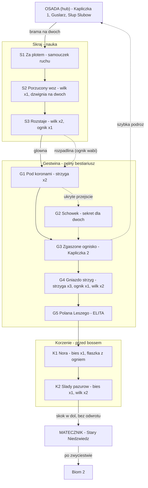

# 🌲 Biom 1: Przeklęty Bór

> Dokument wykonawczy prototypu. Uzupełnia README (GDD). Wszystko podlega zmianie po testach.
> Właściciel: Alex. Uwagi techniczne oznaczone 🔧 są dla Krystiana.

## Spis treści
1. [Klimat i Koncepcja](#1-klimat-i-koncepcja)
2. [Karty Wrogów](#2-karty-wrogów)
3. [Boss: Stary Niedźwiedź](#3-boss-stary-niedźwiedź--włodarz-matecznika)
4. [Layout Pomieszczeń](#4-layout-pomieszczeń)

---

## 1. Klimat i Koncepcja

### Czym jest Bór
Las, który kiedyś należał do ludzi z Osady – zbierali tu chrust, polowali, stawiali kapliczki. Potem coś z głębi zaczęło ciągnąć go w dół. Drzewa rosną krzywo, jakby wyrywane spod ziemi, a korzenie schodzą do jaskiń, których nikt nie wykopał. Osada odgrodziła się od Boru płotem z czaszek – nie po to, by zatrzymać ludzi, ale by zatrzymać to, co patrzy z drzew.

### Nastrój
- **Powierzchnia (Skraj):** jesień, która nigdy się nie kończy. Martwe liście, mgła przy ziemi, światło jeszcze sięga. Ostatnie ślady ludzi – połamany płot, porzucony wóz, zgaszona kapliczka.
- **Gęstwina:** korony zamykają niebo. Światło tylko z błędnych ogników i świecących grzybów. Tu zaczynają się kurhany graczy. Dźwięk: trzaski gałęzi za plecami, nigdy przed.
- **Korzenie:** pod ziemią. Splątane korzenie tworzą ściany i podłogi, między nimi puste przestrzenie – nory. Ciepło i wilgoć, zapach zwierzęcia. Tu leży Matecznik.

### Motyw przewodni: „Bór patrzy"
Mechaniczny i wizualny lejtmotyw bioma. Wrogowie Boru nie szarżują od razu – obserwują i czekają na błąd. W side-scrollerze „osaczenie" realizujemy trzema narzędziami:

1. **Wejście spoza ekranu.** Wrogowie Boru nie stoją w pomieszczeniu i nie czekają – **wbiegają z krawędzi ekranu**, zwykle z tej strony, z której gracze przyszli. Zanim wejdą, przy krawędzi migają świecące oczy (czysto dekoracyjny sprite, bez AI) – to pierwszy sygnał zagrożenia. *W pełnej wersji: wrogowie czający się w warstwie tła (parallax) – poza zakresem prototypu.*
2. **Kleszcze.** Wrogowie działają parami i wchodzą z przeciwnych krawędzi. Gracz odwracający się do jednego odsłania plecy drugiemu. Jedyna obrona to partner pilnujący drugiej strony.
3. **Góra i dół.** Ataki z gałęzi nad graczem i wabienie w rozpadliny pod nim. Bór ma cztery kierunki zagrożenia zamiast dwóch.

Dla level designu: jeśli nie wiesz, gdzie postawić wroga – postaw go tam, gdzie ukarze gracza zostającego z tyłu lub oddalającego się od partnera.

### Struktura pionowa
```
Osada (hub) ─── kapliczka 1 ─── Guślarz ─── Słup Ślubów ─── płot z czaszek (brama)
   │
   ▼ Skraj          (2–3 pomieszczenia: nauka ruchu, pierwsze moby, pierwsze rozwidlenie)
   │
   ▼ Gęstwina       (4–5 pomieszczeń: pełny bestiariusz, elita, kapliczka 2, sekret dla dwóch)
   │
   ▼ Korzenie       (2–3 pomieszczenia: zejście do nory, zapowiedź bossa, arena)
   │
   ▼ Matecznik      (arena bossa)
```

### Boss: Stary Niedźwiedź – Włodarz Matecznika
W wierzeniach słowiańskich niedźwiedź jest zwierzęciem Welesa, pana Nawii. Włodarz to pierwszy sługa Welesa, na jakiego natrafiają gracze – strażnik wejścia w głąb. Nie jest zły. Jest stary, ogromny i broni swojego matecznika, jak bronił go od wieków. Pokonanie go otwiera drogę niżej i – w pełnej wersji – zostawia Bór bez włodarza, co ma konsekwencje („świat pamięta").

### Bestiariusz Boru (zarys)
| Wróg | Typ | Rola w Borze |
|---|---|---|
| **Wilkołak** | Mob | Krwiożercza szarża z krawędzi ekranu, w parach. Rdzeń „Bór patrzy". |
| **Błędny Ognik** | Mob | Dystansowy, wabi gracza w stronę pułapek i innych wrogów. |
| **Strzyga** | Mob | Spada z gałęzi. Pancerz kierunkowy. Reaguje na flaszkę. |
| **Bies** | Mob | Powolny, ciężki, osłona żywiołowa (kora). Uczy czytania zapowiedzi. |
| **Leszy** | Elita | Pan lasu. Rośnie, gdy gracze się rozdzielają. Przywołuje wilkołaki. |
| **Stary Niedźwiedź** | Boss | Włodarz Matecznika. |

### Co Bór uczy gracza (cel dydaktyczny prototypu)
1. **Skraj:** ruch, skok, podstawowy atak, pierwsza wspólna przeszkoda (dźwignia na dwóch).
2. **Gęstwina:** trzymanie się razem ma znaczenie (wilkołaki karzą rozdzielenie), użycie flaszki pod presją (strzyga), pierwsze reakcje łączone.
3. **Korzenie:** czytanie zapowiedzi dużych, wolnych ataków przed bossem (Bies).
4. **Matecznik:** wszystko naraz.

---

## 2. Karty Wrogów

Każda karta ma ten sam układ. Wartości liczbowe (HP, obrażenia) celowo pominięte – ustalimy je w balansie. Zamiast liczb: skala *niskie / średnie / wysokie*.

**Legenda czasowników** (README, sekcja 3): *Osłoń*, *Podpal / Zamroź / Poraź*, *Przerwij*, *Oznacz*.

---

### 🐺 Wilkołak
**Typ:** Mob · **HP:** średnie · **Postawa:** niska (łatwo ogłuszyć)
**Rola:** rdzeń motywu „Bór patrzy". Uczy trzymania się razem i obrony plecami do siebie.

**Zachowanie**
- **Wbiega z krawędzi ekranu** po ostrzeżeniu (oczy migają przy krawędzi ~1 s wcześniej). Nie stoi w pomieszczeniu – pojawia się, gdy gracze wejdą w strefę wyzwalającą.
- **Krwiożerczy:** zawsze wybiera gracza z **niższym zdrowiem**. Jeśli zdrowie jest równe – tego, który jest dalej od partnera.
- Trzyma dystans ~1 ekranu i **szarżuje**. Po szarży (trafionej lub nie) odbiega na dystans i powtarza. Nie staje do wymiany ciosów w zwarciu.
- **Kleszcze:** wilkołaki pojawiają się parami, z przeciwnych krawędzi ekranu. Drugi szarżuje ~1 s po pierwszym – gracz, który uniknął pierwszej szarży przeskokiem, ląduje prosto w drugą, jeśli partner nie pilnuje drugiej strony.

**Ataki**
- *Krwiożercza szarża* – zapowiedź: wilk przykuca, warczy, ~0,6 s. Potem bieg przez cały ekran. Trafienie = powalenie + ugryzienie (obrażenia średnie, krótkie krwawienie). Chybienie = wilk **przebiega dalej i ślizga się** przy hamowaniu, przez ~0,8 s odwrócony plecami.
- *Ugryzienie* – tylko gdy gracz podejdzie do wilka między szarżami. Szybkie, obrażenia niskie.

**Cecha co-op:** celuje w rannego. Gracz z niskim HP jest magnesem – partner musi go *Osłonić* albo wziąć wilki na siebie. Dwoje graczy plecami do siebie przyjmuje każdy z wilków z przodu.

**Słabość**
- **Blok tarczą przeciw szarży** = wilk odbija się i jest ogłuszony (nagroda dla Wojownika). Bariera Maga wchłania szarżę bez ogłuszenia.
- **Poślizg po chybionej szarży** – plecy odsłonięte, pełne okno na atak. Nagroda za unik w ostatniej chwili.
- *Przerwij* w trakcie biegu przewraca wilka.
- *Zamroź* – zamrożony wilk nie szarżuje, podchodzi do zwarcia, gdzie jest słaby.

**Czasownik:** *Osłoń* (konieczny przy dwóch wilkach), *Przerwij*.
**Czego uczy:** trzymania się razem, pilnowania rannego partnera, uniku w ostatniej chwili.

🔧 **Uwaga techniczna:** szarża to ruch po prostej z jednym punktem decyzji (trafił / chybił) – host wyznacza cel i kierunek, klient tylko odtwarza. Dwa wilki to dwa niezależne obiekty bez wspólnej logiki stada; „kleszcze" biorą się tylko z przeciwnych punktów wejścia i opóźnienia spawnu.

---

### 🔥 Błędny Ognik
**Typ:** Mob · **HP:** bardzo niskie · **Postawa:** brak (nie da się ogłuszyć, unosi się)
**Rola:** wabik. Jedyne źródło światła w Gęstwinie – i właśnie dlatego niebezpieczny.

**Zachowanie**
- Unosi się ~2 m nad ziemią. Gdy gracz się zbliża, **cofa się**, zachowując dystans – zawsze w kierunku zagrożenia: rozpadliny, gałęzi ze strzygą, pary wilkołaków.
- Gdy gracz przestaje go gonić, **wraca i kusi** – podlatuje bliżej, miga.
- Ucieka tylko od gracza, **w którego stronę jest zwrócony**. Gracz podchodzący z drugiej strony zaskakuje go.

**Ataki**
- *Iskra* – powolny pocisk, obrażenia niskie, nakłada krótkie podpalenie. Rzuca tylko, gdy gracz jest oddalony.

**Cecha co-op:** wariant *Uciekiniera*. Jeden gracz go goni (ognik cofa się), drugi zachodzi z przeciwnej strony – gracze używają kleszczy Boru przeciwko niemu.

**Słabość**
- Dowolny atak dystansowy lub rzut bronią – jedno trafienie.
- *Zamroź* – zamrożony spada na ziemię i gaśnie.
- Wojownik bez partnera musi rzucić bronią lub wskoczyć – Mag zdejmuje go jednym zaklęciem. Typowa różnica mistrz / wersja słaba.

**Czasownik:** dowolny atak dystansowy; *Zamroź* jako premia.
**Czego uczy:** nie gonić światła; rozdzielać się **świadomie i na krótko**, z planem spotkania.

**Zastosowanie w level designie:** ogniki ustawiać tak, by prowadziły od bezpiecznej ścieżki w stronę pułapki. Gracze uczą się nieufności do światła – a w pełnej wersji mechanika latarni odwróci tę relację.

---

### 🦇 Strzyga
**Typ:** Mob · **HP:** niskie · **Postawa:** średnia
**Rola:** zagrożenie z góry. Nosiciel cechy *Agresja na leczenie*. Nosiciel *Pancerza kierunkowego*.

**Zachowanie**
- Wisi w koronach drzew, niewidoczna poza błyskiem oczu. **Spada na gracza**, który przechodzi pod nią, po czym kilka razy tnie i **wspina się z powrotem** po pniu.
- **Czuje krew:** użycie flaszki w zasięgu ~1 ekranu budzi każdą strzygę w pobliżu – wszystkie spadają na gracza, który się leczył.

**Ataki**
- *Spadnięcie* – zapowiedź: liście sypią się z góry ~0,7 s wcześniej. Obrażenia średnie, odrzut.
- *Cięcie szponami* – seria 2–3 szybkich cięć na planie. Obrażenia niskie każde.

**Pancerz kierunkowy:** z przodu kościany pancerz piersi i szpony – obrażenia zredukowane o połowę. Z tyłu miękki grzbiet i skrzydła – obrażenia pełne, a trafienie w plecy nalicza podwójną postawę.

**Cecha co-op:**
- *Agresja na leczenie* – gracz, który pije flaszkę, staje się celem. Partner musi go *Osłonić* lub przechwycić strzygę w locie.
- *Pancerz kierunkowy* – jeden gracz trzyma strzygę z przodu (blok / parowanie), drugi bije w plecy.

**Słabość**
- Trafiona podczas wspinaczki (*Przerwij*, rzut bronią, pocisk) **spada ogłuszona** – pełne okno na atak.
- *Poraż* – piorun przeskakuje między strzygami wiszącymi blisko siebie. Trzy strzygi w jednym pomieszczeniu to zaproszenie dla Maga.

**Czasownik:** *Osłoń* (reakcja na flaszkę), *Przerwij* (strącenie).
**Czego uczy:** leczyć się **za plecami partnera**, nie w otwartym polu; dzielić role przód / tył.

---

### 🌳 Bies
**Typ:** Mob · **HP:** wysokie · **Postawa:** wysoka (ale patrz: kora)
**Rola:** mini-lekcja przed bossem. Powolny, czytelny, wymagający cierpliwości.

**Zachowanie**
- Chodzi powoli, nigdy nie biegnie. Nie reaguje na pingi ani wabienie – idzie prosto na najbliższego gracza.
- Każdy atak ma **długą, wyraźną zapowiedź** (1–1,5 s): unosi ramiona, trzeszczy kora.

**Ataki**
- *Zamach* – szeroki, poziomy, trafia na ~2 m przed sobą. Nieparowalny bez tarczy. Obrażenia wysokie.
- *Tupnięcie* – fala wstrząsu po ziemi w obie strony. Unik przez skok. Obrażenia średnie.

**Osłona żywiołowa (kora):** dopóki ma korę, **nie przyjmuje obrażeń ani postawy**. Kora znika po nałożeniu statusu:
- *Podpal* – kora płonie i odpada w ~2 s (mistrz: zaklęcie Maga; słaba: naoliwione ostrze Wojownika – 4–5 ciosów; przedmiot: flaszka z ogniem).
- *Zamroź* – kora pęka po jednym silnym uderzeniu.
- Po utracie kory Bies jest **wolny i miękki** – pełne obrażenia, postawa łamie się szybko.

**Cecha co-op:** *Osłona żywiołowa*. Jeden gracz zdejmuje korę, drugi w tym czasie unika zamachów i trzyma uwagę.

**Słabość**
- Bez kory. Dodatkowo: ciężki, więc **zrzucenie z półki** zadaje mu duże obrażenia od upadku – nagroda za wykorzystanie wertykalności.

**Czasownik:** *Podpal / Zamroź* (konieczny), *Osłoń* (pomocny przy zamachu).
**Czego uczy:** czytania zapowiedzi, cierpliwości, kolejności działań (najpierw status, potem obrażenia) – dokładnie tego, czego wymaga Stary Niedźwiedź.

**Pierwszy do wycięcia**, jeśli zakres prototypu okaże się za duży.

---

### 🌲 Leszy – Elita
**Typ:** Elita · **HP:** wysokie · **Postawa:** zależna od rozmiaru
**Rola:** pan Boru. Ucieleśnienie „Bór patrzy" i kara za rozdzielenie. Własna mini-arena w Gęstwinie.
**Nemesis:** w prototypie **wyłączony** – ale każde zabójstwo gracza przez Leszego jest logowane do SQLite.

**Mechanika główna: rozmiar zależy od dystansu między graczami**
Leszy ma trzy formy. Przełącza się płynnie w zależności od tego, jak daleko od siebie są gracze:

| Forma | Warunek | Właściwości |
|---|---|---|
| **Człowiek** | gracze blisko (< ½ ekranu) | Wielkości gracza. Postawa niska – **można go ogłuszyć i ranić**. Słabe ataki. |
| **Olbrzym** | gracze rozdzieleni (½–1 ekran) | Dwa razy wyższy. Zasięg i obrażenia rosną. Postawa średnia. |
| **Drzewo** | gracze daleko (> 1 ekran) lub jeden martwy | Sięga sufitu. Nietykalny. Przywołuje wilkołaki z krawędzi areny i tupaniem zrzuca strzygi. |

**Zasada:** Leszego pokonuje się wyłącznie w formie Człowieka. Cała walka to **walka o trzymanie się razem** przeciwko mechanikom, które próbują graczy rozdzielić.

**Jak rozdziela graczy**
- *Wypchnięcie korzeniem* – korzeń wystrzela spod ziemi pod jednym graczem i odrzuca go na drugi koniec areny. Zapowiedź: ziemia pęka 0,8 s wcześniej.
- *Kurtyna gałęzi* – na środku areny wyrasta ściana gałęzi na ~4 s, blokując przejście (nie wzrok). Gracze muszą ją przeciąć (*Podpal* natychmiast, cios tarczą – wolniej) lub obejść górą.
- *Wołanie Boru* – w formie Drzewa: 2 wilkołaki wbiegają z przeciwnych krawędzi areny.

**Ataki (forma Człowiek / Olbrzym)**
- *Cios pazurami* – zwykły atak w zwarciu. Zapowiedź krótka. Obrażenia rosną z formą.
- *Rzut kamieniem* – gdy gracz jest poza zasięgiem. Łatwy do przeskoczenia.

**Cecha co-op:** wszystko w tej karcie. Leszy jest testem, czy gracze zrozumieli lekcję wilkołaków.

**Słabość**
- Forma Człowieka: *Przerwij* ogłusza, pełne okno na obrażenia. Reakcje łączone działają normalnie.
- *Podpal* w dowolnej formie tnie czas Kurtyny i przyspiesza powrót do mniejszej formy (ogień „odstrasza" las).
- **Oczy:** w każdej formie Leszy zamyka oczy na chwilę przed atakiem rozdzielającym – wizualna zapowiedź spójna z motywem.

**Czasownik:** *Przerwij* (konieczny), *Podpal* (bardzo pomocny), *Osłoń* (przy Wypchnięciu – partner może zasłonić).
**Czego uczy:** że „Bór patrzy" to nie klimat, tylko reguła.

**W pełnej wersji (Nemesis):** Leszy, który zabije gracza, zapamiętuje, *jak* gracze się rozdzielili (np. przez Kurtynę) – i przy kolejnym spotkaniu zaczyna od tej mechaniki, z dodatkową cechą.

🔧 **Uwaga techniczna:** dystans między graczami liczy host; zmiana formy to zmiana jednej wartości stanu (0/1/2) z animacją przejścia po obu stronach. Formy nie powinny migotać przy granicy progu – potrzebna histereza (np. przejście w górę przy 0,55 ekranu, w dół przy 0,45).

---

## 3. Boss: Stary Niedźwiedź – Włodarz Matecznika

**Typ:** Boss, wielka bestia · **Fazy:** 2, w jednej arenie · **Adaptacja:** w prototypie wyłączona, śmierci logowane do SQLite.

### Czego ten boss wymaga (egzamin z Boru)
| Lekcja z Boru | Nauczył | Niedźwiedź sprawdza przez |
|---|---|---|
| Trzymać się razem | Wilkołak, Leszy | *Uchwyt* – złapany gracz ginie bez partnera. *Ryk* rozdziela graczy, trzeba wrócić. |
| Leczyć się za plecami partnera | Strzyga | *Węch krwi* – skok na gracza, który pije flaszkę, chyba że partner stoi między nimi. |
| Najpierw status, potem obrażenia | Bies | *Futro Włodarza* – bez statusu obrażenia prawie zerowe. |

Gracz, który zignorował którąś lekcję w Borze, dostanie ją tu z nawiązką – ale bez niespodzianek: wszystkie mechaniki bossa to **większe wersje tego, co już widział**.

### Arena: Matecznik
- Owalna nora pod korzeniami, ok. **2,5 ekranu szerokości**, 1 ekran wysokości. Podłoga z ubitej ziemi i korzeni.
- **Dwie półki** – po jednej przy każdej ścianie, na wysokości skoku. Boss nie wchodzi na półki, ale sięga ich łapą i strąca graczy Rykiem.
- **Ściany** – twarde. Niedźwiedź, który uderzy w ścianę podczas szarży, jest ogłuszony (patrz: Szarża).
- **Zwisające korzenie** nad środkiem areny *(opcjonalnie w prototypie)* – gracz na półce może je ściąć, by spadły na bossa pod nimi: obrażenia + ogłuszenie. Wymaga jednego gracza na górze i drugiego wabiącego na dole.
- Wejście z góry (gracze spadają do nory – brak odwrotu). Wyjście otwiera się po zwycięstwie: korzenie w dnie rozstępują się w dół, do biomu 2.

### Mechaniki stałe (obie fazy)

**Futro Włodarza** – *osłona żywiołowa bossa*
- Bez statusu Niedźwiedź przyjmuje **~20% obrażeń** i nie traci postawy.
- Nałożenie statusu otwiera **okno pełnych obrażeń** na ~6 s:
  - *Podpal* – futro płonie, Niedźwiedź przez chwilę **tarza się** (dodatkowe 1,5 s bez ataku). Najlepsza opcja.
  - *Zamroź* – futro sztywnieje i pęka pod ciosami, boss **spowolniony** w oknie.
  - *Poraż* – okno krótsze (~4 s), ale piorun przerywa bieżący atak.
- Po oknie futro „otrząsa się" – potrzebny nowy status. Rytm walki: **status → okno → odskok → status**.
- Wersja słaba (naoliwione ostrze Wojownika) też działa, ale wymaga ~5 trafień w futro przy 20% obrażeń – czyli wejścia w zwarcie na dłużej. Flaszka z ogniem w arenie (jedna, odnawia się przy kapliczce) jako wyjście awaryjne.

**Węch krwi** – *agresja na leczenie*
- Użycie flaszki = Niedźwiedź **przerywa cokolwiek robi** i wykonuje *Skok* na leczącego się gracza (zapowiedź: uniesiony pysk, wciągnięcie powietrza, ~0,8 s).
- Jeśli **partner stoi między** bossem a leczącym – Skok trafia partnera (blok tarczą go anuluje; bariera Maga wchłania). Leczenie za plecami partnera jest jedynym bezpiecznym leczeniem.
- Dodatkowo: gracz **z krwawieniem** (od Wilkołaka, gryzienia bossa) jest preferowanym celem zwykłych ataków.

**Postawa**
- Pasek postawy łamie się tylko w oknie statusu (lub przy uderzeniu w ścianę). Złamanie = Niedźwiedź pada na ~3 s, głowa na ziemi – **moment na Atak Zgrany**.

### Faza 1 – Włodarz (100% → 50% HP)
Powolny, ciężki, każdy atak ma długą zapowiedź. Walka o rytm.

| Atak | Zapowiedź | Efekt | Odpowiedź |
|---|---|---|---|
| **Łapa** | Uniesienie jednej łapy, ~0,9 s | Poziomy zamach ~2 m. Obrażenia wysokie, odrzut. | Odskok w tył lub blok tarczą (kosztuje dużo wytrzymałości). Nieparowalne. |
| **Zwalenie** | Staje dęba, ~1,2 s | Uderza przednimi łapami w ziemię. Fala wstrząsu w obie strony, cała szerokość areny. | Skok. Gracz na półce bezpieczny. |
| **Szarża** | Kopie w ziemię, ~1 s | Bieg przez arenę do ściany. Trafienie = powalenie + krwawienie. | Unik w ostatniej chwili lub wejście na półkę. **Boss uderza w ścianę → ogłuszony 2 s**, futro się nie liczy. Nagroda za wabienie pod ścianę. |
| **Uchwyt** – *mechanika dwuosobowa* | Otwiera paszczę, patrzy na jednego gracza, ~1 s | Łapie gracza w zasięgu i unosi. Co ~1 s zadaje obrażenia średnie. Po 4 s – **rzut o ziemię, obrażenia bardzo wysokie** (zwykle śmierć). | Złapany gracz nic nie może. **Partner musi** *Przerwać*: uderzenie tarczą w łapę / impuls Maga / rzut bronią w pysk. Uwolniony gracz spada, Niedźwiedź cofa się na 2 s. |

- *Uchwyt* pojawia się po raz pierwszy ok. 80% HP, potem co ~25 s. To egzamin z „trzymajcie się razem": partner oddalony o ekran nie zdąży.
- W fazie 1 nie ma dodatkowych wrogów.

### Przejście (50% HP)
- Niedźwiedź staje dęba i wydaje **Ryk**: obaj gracze zostają odrzuceni do przeciwnych ścian (gracze na półkach – strąceni). Niedźwiedź nietykalny ~3 s, zrywa z siebie płonące/zmrożone kłaki – futro w fazie 2 jest podarte.
- Gracze zaczynają fazę 2 **rozdzieleni**, z bossem między nimi. Pierwsza decyzja fazy 2: jak się połączyć.
- 🔧 Przejście to jedno zdarzenie stanu bossa (faza 1 → 2), host wymusza pozycje graczy po odrzucie.

### Faza 2 – Rozjuszony (50% → 0%)
Szybszy, mniej cierpliwy. Zapowiedzi krótsze o ~30%. Te same ataki, nowe konsekwencje.

| Zmiana | Efekt |
|---|---|
| **Futro podarte** | Obrażenia bez statusu rosną do ~40%, ale okno statusu skraca się do ~4 s. Status nadal konieczny do postawy. |
| **Szarża odbita** | Po uderzeniu w ścianę boss już nie jest ogłuszony – **odbija się i szarżuje z powrotem**. Unik potrzebny dwa razy. Ogłuszenie tylko, gdy w momencie uderzenia w ścianę jest w oknie statusu. |
| **Podwójna Łapa** | Dwa zamachy pod rząd, drugi z krótszą zapowiedzią. Pierwszy odskok nie wystarcza. |
| **Uchwyt** | Co ~15 s zamiast 25 s. Rzut o ziemię po 3 s zamiast 4. |
| **Ryk** (nowy) | Co ~30 s: odrzut obu graczy do ścian, jak przy przejściu, ale bez nietykalności. Wymusza ponowne łączenie się pod presją. |

- *(Opcjonalnie)* Przy 25% HP z sufitu spadają **2 strzygi** – jeśli gracze leczą się w tym momencie, dostają podwójną karę. Pierwsze do wycięcia.

### Śmierć bossa
- Niedźwiedź nie umiera z rykiem – **kładzie się**. Kilka sekund ciszy. Dopiero potem korzenie w dnie rozstępują się.
- **Drop:** po jednym przedmiocie dla każdej klasy (README, sekcja 3) – np. *Pazur Włodarza* (broń Wojownika o wysokim zużyciu i potężnym rzucie) i *Kieł Włodarza* (fokus Maga wydłużający okno statusu).
- **Świat pamięta:** w Gęstwinie gasną oczy przy krawędziach ekranu – Bór przestaje patrzeć. Guślarz w Osadzie ma nową kwestię. *(W pełnej wersji: Bór bez włodarza zaczyna zarastać Osadę.)*

### Adaptacja w pełnej wersji (prototyp tylko loguje)
| Co robili gracze przed śmiercią | Czego Niedźwiedź się uczy |
|---|---|
| Stali daleko, bili z dystansu | *Rzut głazem* – atak na dystans. |
| Blokowali każdą Łapę tarczą | *Łapa z rozbiegu* – przełamuje blok. |
| Używali tylko ognia | Futro przestaje płonąć – tylko lód i piorun otwierają okno. Uczy różnorodności. |

### Zakres w prototypie
- Faza 1 i 2 w pełni, Uchwyt jako jedyna wymagana mechanika dwuosobowa.
- Futro, Węch krwi, postawa, przejście z Rykiem.
- **Opcjonalnie:** zwisające korzenie, strzygi przy 25%.
- **Poza zakresem:** adaptacja (tylko logowanie), kwestia Guślarza po zwycięstwie (może być jedną z 5 kwestii warunkowych – patrz README sekcja 2).

🔧 **Uwaga techniczna:** boss to jedna maszyna stanów po stronie hosta; klient dostaje stan (atak, faza, cel) i odtwarza animację. Uchwyt wymaga, by host „przypiął" pozycję złapanego gracza do łapy bossa – klient nie może w tym czasie wysyłać ruchu. To pierwsze miejsce w prototypie, gdzie host przejmuje kontrolę nad postacią klienta.

## 4. Layout Pomieszczeń

Osada + 11 pomieszczeń + arena. Oznaczenia: **S** = Skraj, **G** = Gęstwina, **K** = Korzenie. Szacowany czas przejścia bez śmierci: 25–35 min.

### Schemat



### Krzywa napięcia
```
intensywność
    ▲
 ██ │                                              ████
 ▓▓ │                                    ████      ████
 ▒▒ │                   ████    ████     ████  ██  ████
 ░░ │   ░░   ▒▒   ▓▓    ████ ░░ ████ ▒▒  ████  ▒▒  ████
    └────┬────┬────┬─────┬────┬────┬────┬─────┬────┬─────
        S1   S2   S3    G1   G2   G3   G4   G5    K1   K2  ARENA
                                   ⛩️        ELITA
```
Zasada: po każdym szczycie (G5, K2) **nie ma** odpoczynku – kapliczka 2 jest *przed* Leszym, nie po nim. Gracze idą na bossa z tym, co im zostało. To celowe: testuje gospodarowanie flaszką na dłuższym dystansie.

### Karty pomieszczeń

#### OSADA – Hub
| | |
|---|---|
| **Cel** | Start gry, bezpieczeństwo, wybór Ślubów, powrót po śmierci obojga. Jedyne miejsce, gdzie nic nie grozi. |
| **Rozmiar** | 1 ekran, płaski – bez platform. Gracz ma od razu zrozumieć, że to nie jest poziom. |
| **Układ (od lewej)** | ⛩️ **Kapliczka 1** (punkt startu i respawnu) → **Guślarz** z księgą, tuż obok (`npc-guslarz.md`) → **Słup Ślubów** (rzeźbiony totem, interakcja = wybór Ślubu) → zamknięta chata Kupca *(placeholder, poza zakresem)* → **Płot z czaszek** z bramą na prawej krawędzi – wyjście do S1. |
| **Nastrój** | Zmierzch, ostatnie ciepłe światło w grze. Dym z kominów, ale okiennice zamknięte – mieszkańców nie widać. Osada boi się Boru bardziej niż gracze. Jedyny ruch to płomień kapliczki. |
| **Pierwsze 30 sekund** | Obaj gracze pojawiają się przy kapliczce (host pierwszy). Gdy oboje są obecni, Guślarz wypowiada kwestię pierwszej wizyty – bez interakcji, sam. Podpowiedź sterowania (ruch, ping) pojawia się dopiero po jego słowach. Droga jest jedna: w prawo. |
| **Śluby** | Interakcja ze Słupem otwiera listę. Ślub osobisty wybiera każdy sam; Ślub wspólny wymaga potwierdzenia obojga (drugi gracz widzi propozycję i zatwierdza). Zmiana możliwa tu i przy kapliczce 2. |
| **Klasy** | Wybierane w lobby przed wejściem do gry, nie w Osadzie. *(Prototyp – w pełnej wersji Słup mógłby obsługiwać też zmianę klasy.)* |
| **Brama** | Otwiera się, gdy **oboje** gracze przy niej stoją. Pierwsza, najłagodniejsza lekcja „razem" – bez wrogów, bez kary, tylko czekanie na partnera. |
| **Co-op** | Nic wymuszonego poza bramą. Osada ma być oddechem. |
| **Wejścia / wyjścia** | Szybka podróż z kapliczki 2 (gracze pojawiają się przy kapliczce 1) → brama w prawo do S1. |
| **Świat pamięta** | *Prototyp:* kwestie Guślarza. *Pełna wersja:* na płocie przybywa czaszek po każdej śmierci w Borze; po pokonaniu Włodarza otwiera się jedna okiennica. |
| **Uwagi** | Osada nie ma tła z drzewami – las widać dopiero za bramą. Granica ma być ostra. 🔧 Scena startowa po lobby; punkt respawnu po śmierci obojga, gdy ostatnią odwiedzoną kapliczką była kapliczka 1. Brama korzysta z ogólnej zasady przejść (oboje przy wyjściu) – zero osobnego kodu. |

#### S1 – Za płotem
| | |
|---|---|
| **Cel** | Nauka ruchu, skoku, zejścia w dół. Pierwszy ekran lasu – bez zagrożeń. |
| **Wrogowie** | Brak. |
| **Co-op** | Pierwszy ping: gra podpowiada „wskaż partnerowi przejście" przy zejściu. |
| **Wejścia / wyjścia** | Z Osady przez bramę (lewo) → w dół do S2. |
| **Uwagi** | Jeden ekran. Oczy przy krawędzi migają raz, bez wroga – zapowiedź motywu. Tu zaczyna się jesień i mgła – granica z Osadą ma być widoczna w jednej klatce. |

#### S2 – Porzucony wóz
| | |
|---|---|
| **Cel** | Pierwszy wróg. Nauka szarży wilka i bloku tarczą. Pierwsza przeszkoda na dwóch. |
| **Wrogowie** | 🐺 ×1 (pojedynczy – bez kleszczy). |
| **Co-op** | **Dźwignia na dwóch:** dwie dźwignie w odległości ~1 ekranu, obie muszą być pociągnięte w ciągu 3 s. Otwiera kratę w dół. Rozdziela graczy *celowo*, w bezpiecznym miejscu – żeby poznali wskaźnik partnera poza ekranem. |
| **Wejścia / wyjścia** | Z S1 (góra) → w dół do S3. |
| **Uwagi** | Wilk wchodzi dopiero, gdy gracze podejdą do dźwigni – pierwszy raz uczą się, że rozdzielenie ma cenę. |

#### S3 – Rozstaje
| | |
|---|---|
| **Cel** | Kleszcze. Nieufność do światła. Pierwsze rozwidlenie. |
| **Wrogowie** | 🐺 ×2 (pierwsze kleszcze), 🔥 ×1. |
| **Co-op** | Plecami do siebie przeciw dwóm wilkom. Ognik wabi w prawo, w rozpadlinę – spadnięcie zadaje obrażenia i zrzuca do G1 z gorszej strony (pod strzygi). |
| **Wejścia / wyjścia** | Z S2 → **główna** w dół po lewej (do G1) / **rozpadlina** po prawej (też do G1, ale z obrażeniami i lądowaniem w środku pomieszczenia). |
| **Uwagi** | Obie drogi prowadzą w to samo miejsce – kara jest łagodna, lekcja czytelna. |

#### G1 – Pod koronami
| | |
|---|---|
| **Cel** | Góra jako kierunek zagrożenia. Czytanie spadających liści. |
| **Wrogowie** | 🦇 ×2, zawieszone nad ścieżką w odstępie. |
| **Co-op** | Pancerz kierunkowy: jedno trzyma z przodu, drugie bije w plecy. Jeśli ktoś się leczy – obie strzygi spadają na niego. |
| **Wejścia / wyjścia** | Z S3 (góra-lewo lub środek, zależnie od drogi) → dalej w prawo do G3. **Ukryte przejście** za pniem po lewej, widoczne po pingu – do G2. |
| **Uwagi** | Ciemność zaczyna się tutaj. Świecące grzyby wyznaczają ścieżkę. |

#### G2 – Schowek *(opcjonalny, sekret dla dwóch)*
| | |
|---|---|
| **Cel** | Nagroda za eksplorację i współpracę. Test przekazywania przedmiotów. |
| **Wrogowie** | Brak. |
| **Co-op** | **Przycisk podłogowy** trzyma wysuniętą półkę. Jeden gracz stoi na przycisku, drugi wchodzi po półce do schowka, bierze przedmiot **dla klasy partnera** i musi mu go przekazać (README, sekcja 3). |
| **Wejścia / wyjścia** | Z G1 (ukryte) → wyjście w dół do G3 (zapadnia, jednokierunkowa). |
| **Uwagi** | Przedmiot zawsze dla *drugiej* klasy – nigdy dla tej, która po niego sięga. |

#### G3 – Zgaszone ognisko
| | |
|---|---|
| **Cel** | Odpoczynek. Ostatnie bezpieczne miejsce przed bossem. |
| **Wrogowie** | Brak. |
| **Co-op** | Zmiana Ślubu możliwa tylko tutaj (i w Osadzie). Jedyny moment na przebudowanie duetu przed Leszym i Niedźwiedziem. |
| **Wejścia / wyjścia** | Z G1 / G2 → w dół do G4. Szybka podróż do Osady. |
| **Świat pamięta** | ⛩️ Kapliczka 2. Ognisko *zapala się* po pokonaniu Niedźwiedzia (pełna wersja). |
| **Uwagi** | Gracze powinni zrozumieć, że to ostatnia kapliczka – wyraźna wizualna granica (korzenie zasłaniają dalszą drogę jak kurtyna). |

#### G4 – Gniazdo strzyg
| | |
|---|---|
| **Cel** | Test leczenia pod presją. Okazja dla pioruna. Pionowy szyb w dół. |
| **Wrogowie** | 🦇 ×3 (blisko siebie – łańcuch *Poraż*), 🔥 ×1 wabi pod nie, 🐺 ×2 wchodzą, gdy pierwsza strzyga padnie. |
| **Co-op** | Największy chaos przed bossem. Jeśli gracze piją flaszkę w otwartym polu – trzy strzygi naraz. Pierwsza realna szansa na reakcje łączone (Zamroź → Uderzenie tarczą na spadającą strzygę). |
| **Wejścia / wyjścia** | Z G3 (góra) → **szyb** w dół do G5 (drabina z korzeni, ruch w dół łatwy, w górę wolny). |
| **Uwagi** | Pomieszczenie najwyższe w biomie – 2 ekrany wysokości. Strzygi na różnych poziomach. |

#### G5 – Polana Leszego
| | |
|---|---|
| **Cel** | Egzamin z „trzymajcie się razem". Elita. |
| **Wrogowie** | 🌲 Leszy (karta w sekcji 2). Wilkołaki tylko z jego wołania. |
| **Co-op** | Cała walka (patrz karta). |
| **Wejścia / wyjścia** | Z G4 (szyb, góra) → po pokonaniu Leszego korzenie na dnie polany rozstępują się → K1. |
| **Świat pamięta** | Śmierci graczy tutaj logowane jako „zabójca: Leszy" – fundament Nemesis. |
| **Uwagi** | Arena 2 ekrany szerokości, bez półek – wszystko dzieje się na jednym poziomie, żeby dystans między graczami był czytelny. |

#### K1 – Nora
| | |
|---|---|
| **Cel** | Nauka „najpierw status, potem obrażenia" w kontrolowanych warunkach. |
| **Wrogowie** | 🌳 Bies ×1, w ciasnym tunelu (nie da się go ominąć). |
| **Co-op** | Osłona żywiołowa. Obok wejścia leży **flaszka z ogniem** – gra pokazuje wersję „przedmiot" czasownika, zanim gracze będą jej potrzebować u bossa. |
| **Wejścia / wyjścia** | Z G5 (góra) → tunel w prawo-dół do K2. |
| **Uwagi** | Ciepło, wilgoć, zapach zwierzęcia – zmiana tła i dźwięku zapowiada Matecznik. Tunel ma jedną półkę, z której można zrzucić Biesa. |

#### K2 – Ślady pazurów
| | |
|---|---|
| **Cel** | Ostatni test przed bossem: status + osłona + kleszcze naraz. Punkt bez odwrotu. |
| **Wrogowie** | 🌳 Bies ×1 + 🐺 ×2 (wchodzą, gdy Bies straci korę). |
| **Co-op** | Jeden zdejmuje korę, drugi przyjmuje szarże wilków. Pełna próba generalna. |
| **Wejścia / wyjścia** | Z K1 → **skok w dół** do Matecznika. Przed krawędzią: ślady pazurów na ścianie, kości, pulsujące oczy w ciemności na dole. Wyraźny komunikat: „dalej nie ma odwrotu". |
| **Świat pamięta** | Kurhany graczy, którzy tu zginęli, widoczne z krawędzi (pełna wersja: komentarz Guślarza o „progu Matecznika"). |
| **Uwagi** | Gracze, którzy skoczą rozdzieleni (jeden wcześniej), lądują w arenie w różnych momentach – boss zaczyna od Uchwytu na pierwszego. Gra nagradza skok razem. |

#### MATECZNIK – Arena
Patrz sekcja 3. Wejście z góry, wyjście w dół po zwycięstwie.

### Zasady layoutu (do przestrzegania przy zmianach)
1. Każde pomieszczenie ma **jeden cel dydaktyczny**. Jeśli ma dwa – dzielimy je.
2. Każdy wróg pojawia się po raz pierwszy **sam lub w prostej konfiguracji**, zanim trafi do mieszanki.
3. Każde rozwidlenie prowadzi **do tego samego miejsca** – kara za zły wybór to obrażenia lub gorsza pozycja, nigdy zgubienie się.
4. Ruch w dół jest zawsze łatwy, w górę zawsze wolny lub niemożliwy. Gracze mają czuć, że schodzą.
5. Kapliczka 2 jest *przed* elitą i bossem – gracze idą na egzamin bez pełnej flaszki, jeśli byli nieostrożni.

### Zakres w prototypie
- Osada + wszystkie 11 pomieszczeń + arena. G2 (sekret) jako pierwszy do wycięcia, jeśli brakuje czasu.
- Greybox (prostokąty i platformy bez grafiki) wystarczy do testów M1.
- 🔧 Każde pomieszczenie to osobna scena Godota; przejścia między nimi synchronizuje host (obaj gracze ładują nową scenę, gdy *oboje* dotkną wyjścia – albo gdy jeden skoczy do Matecznika).
