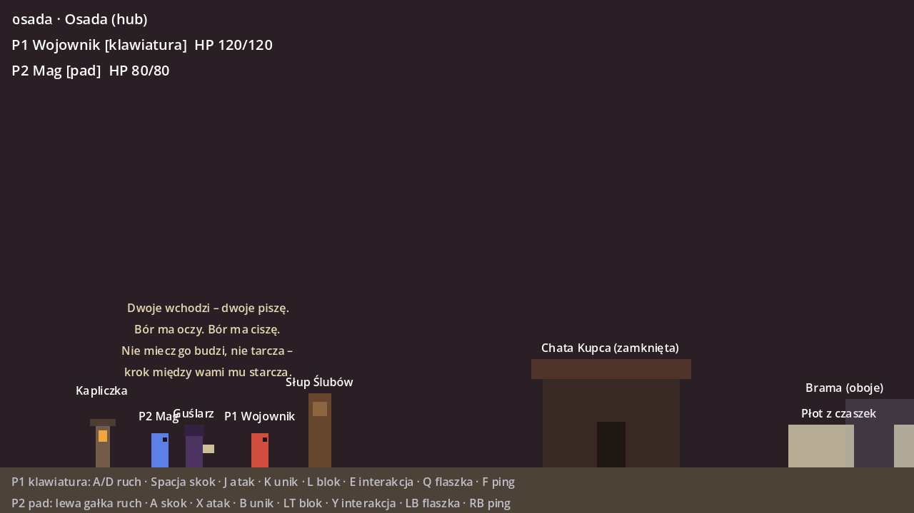
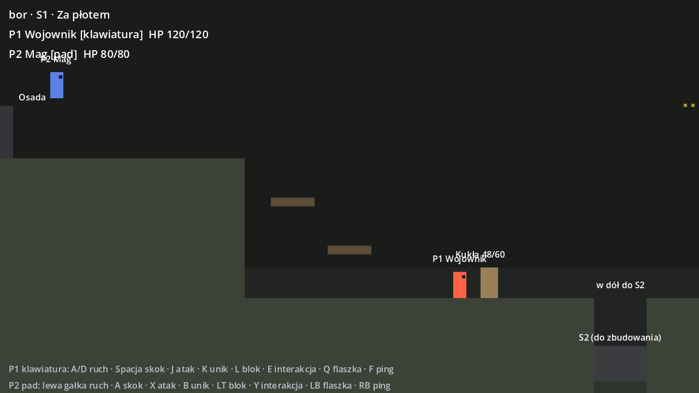
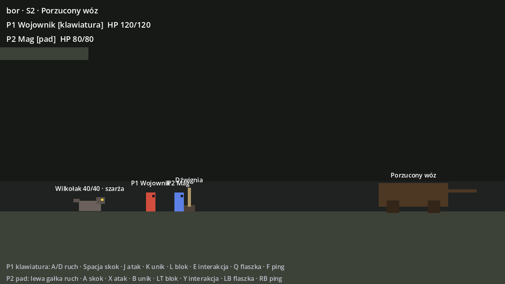
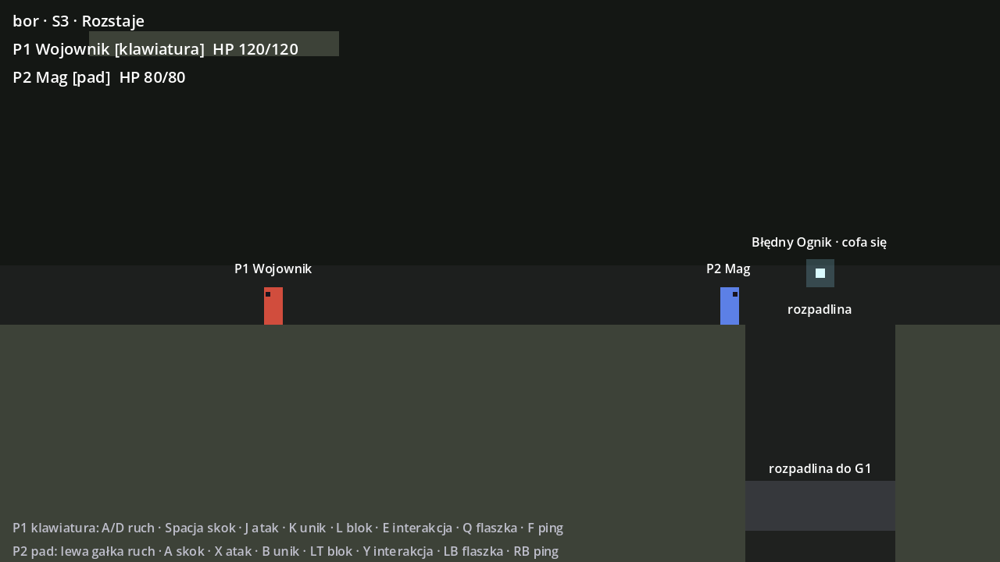
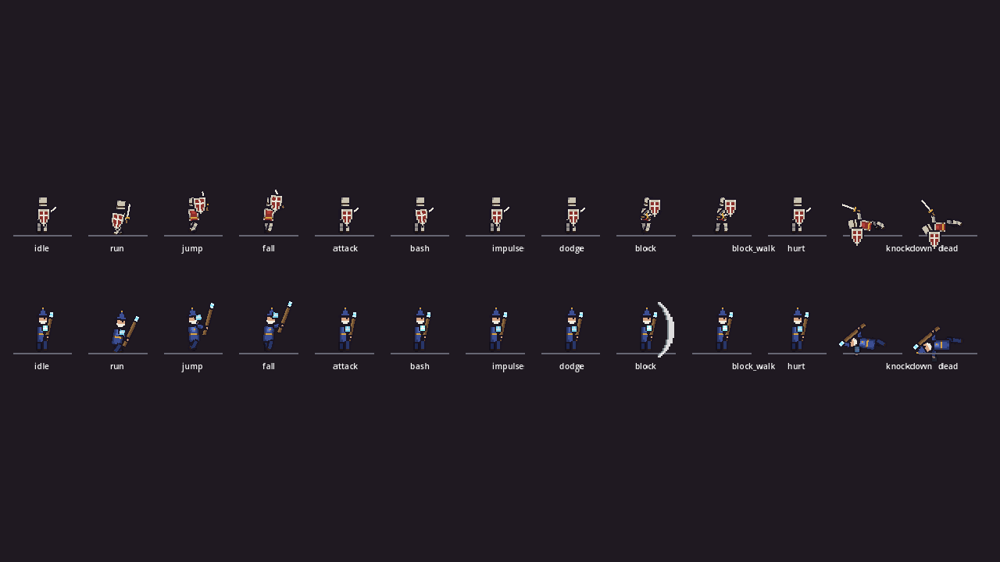

# Uruchomienie i sprawdzenie projektu

Stan: **M0, krok 1** (dwie postacie w jednym procesie, bez sieci). Kolejne kroki: [`technika.md`](technika.md#kolejność-prac-w-m0).






Folder `docs/` ma plik `.gdignore`, więc Godot nie importuje tych obrazków jako zasobów gry.

## Wymagania

- Godot **4.7.2-stable**, build standardowy (bez .NET), ta sama wersja u obojga.
- Git. Git LFS dopiero, gdy ustalimy to w sekcji 7 README.

## Otwarcie w edytorze

1. Project Manager → *Import* → wskaż `project.godot` z tego folderu.
2. F5 uruchamia scenę główną `scenes/main.tscn`: Osada z Guślarzem, kapliczką i Słupem Ślubów, dalej brama do S1.

Ostrzeżenia o brakujących typach i niebezpiecznych wywołaniach są w `project.godot` ustawione na **błąd** (`debug/gdscript/warnings/*`). Skrypt bez typu nie uruchomi się, zgodnie z decyzją z sekcji 1 README.

## Sterowanie (krok 1)

| Akcja | P1 klawiatura (`kb_*`) | P2 pad (`pad_*`) |
|---|---|---|
| Ruch | A / D (strzałki) | lewa gałka, d-pad |
| Skok | Spacja | A |
| Atak | J | X |
| Unik | K | B |
| Blok (Wojownik: tarcza; Mag: bariera) | L | LT |
| Interakcja | E | Y |
| Przerwij (Wojownik: uderzenie tarczą; Mag: impuls) | I | RT |
| Zmiana żywiołu pocisku (Mag) | R | wciśnięcie prawej gałki |
| Flaszka (krok 3) | Q | LB |
| Ping (M1) | F | RB |

Każdy profil ma własny zestaw akcji w mapie wejścia, więc jedna postać czyta tylko klawiaturę, a druga tylko pad. W kroku 2 M0 każda instancja dostanie inny profil i to samo rozwiązanie zadziała w sieci. Numer urządzenia pada jest dziś `-1` (dowolny pad); przy dwóch padach trzeba go przypiąć w `project.godot`.

Która postać jest na którym urządzeniu i jaką ma klasę, ustawia się w inspektorze węzła `Main` (`p1_stats`, `p1_profile`, `p2_stats`, `p2_profile`).

## Sprawdzenie bez edytora

Oba polecenia zakładają, że `godot` to plik `Godot_v4.7.2-stable_win64.exe` (można go dodać do PATH). Pierwsze uruchomienie po klonie wymaga importu:

```bash
godot --headless --path . --import
```

Ładowanie każdego skryptu, sceny i zasobu (kod wyjścia 1 przy błędzie):

```bash
godot --headless --path . --script res://tools/check_project.gd
```

Test dymny, który sam steruje obiema postaciami (brama na dwóch, przejście do S1, atak na kukłę, skok na padzie):

```bash
godot --headless --path . res://tools/smoke_test.tscn
```

Test dymny S2 (wilkołak wbiega po wejściu w strefę dźwigni, szarża trafia i nakłada krwawienie, blok tarczą odbija i ogłusza, ciosy krytyczne zabijają, dźwignia na dwóch otwiera kratę, zejście w dół):

```bash
godot --headless --path . res://tools/smoke_test_s2.tscn
```

Test dymny S3 (kleszcze dwóch wilków z przeciwnych krawędzi, ognik cofa się przed goniącym go graczem nad rozpadlinę, upadek zadaje obrażenia, wyjście na dnie po 5 s przeciąga partnera):

```bash
godot --headless --path . res://tools/smoke_test_s3.tscn
```

Testy dymne wciskają akcje przez `Input.action_press`, więc sprawdzają tę samą ścieżkę co prawdziwe urządzenia.

## Czasowniki i statusy (README, sekcja 3 i 4)

| Czasownik | Wojownik | Mag |
|---|---|---|
| Osłoń | tarcza (L / LT, trzymanie): blok z przodu, szarża wilka odbija się i ogłusza wilka | bariera (L / LT): łuk przed Magiem, wchłania jeden cios z przodu, 20 s odnowienia |
| Podpal / Zamroź / Poraź | brak (naoliwione ostrze dojdzie z ekwipunkiem) | pocisk (J / X) w żywiole wybranym klawiszem R / prawą gałką |
| Przerwij | uderzenie tarczą (I / RT): 4 obrażeń, 30 postawy, przewraca wilka w biegu | impuls (I / RT): bez obrażeń, ogłusza wrogów w promieniu 44 px, 8 s odnowienia |

Statusy na wrogach (`Enemy`): **podpalenie** zadaje 2 obrażeń co pół sekundy, **zamrożenie** spowalnia do 40 % (zamrożony wilk nie szarżuje, podchodzi do zwarcia), **porażenie** przeskakuje na wrogów w promieniu 56 px. Reakcja z zakresu prototypu: **zamrożony + cios fizyczny = roztrzaskanie** (plus 15 obrażeń, złamana postawa, połowa tych obrażeń dla wrogów w promieniu 40 px). Osłona żywiołowa (`EnemyStats.elemental_shield`, kora Biesa) blokuje ciosy, dopóki nie nałoży się statusu: ogień zdejmuje ją po 2 s, lód sprawia, że pęka od następnego ciosu. Na graczach działa podpalenie (iskra ognika) i zamrożenie (spowolnienie o połowę). Liczby: `resources/balance/enemy_stats.gd` i `player_stats.gd` (grupy „Statusy żywiołowe”, „Przerwij”).

Test: `godot --headless --path . res://tools/smoke_test_verbs.tscn` (podpalenie, zamrożenie, impuls, roztrzaskanie na wilku w S2).

## Grafika: rigi z części (próba)

Obie klasy mają pierwszą prawdziwą grafikę: postać złożoną z części (głowa, tułów, dwie ręce, dwie nogi z kolanem, czyli udo i goleń, broń), każda jako mały pikselowy sprite, a animacje to klatki kluczowe na obrotach przegubów w `AnimationPlayer`. Wojownik to rycerz z mieczem i tarczą, Mag ma spiczasty kapelusz, brodę, szatę z gwiazdą, laskę z kryształem i fokus (świecącą kulę). Wspólna mechanika siedzi w `PartsRig`, a każda klasa dodaje tylko własne animacje.

Mag walczy z dystansu (README, sekcja 3): atak to pocisk ognia z laski (`PlayerStats.projectile_scene`, zasięg 220 px, podpala), czyli czasownik *Podpal* w wersji mistrza. Obrona to bariera pod klawiszem bloku: łuk przed Magiem, wyższy od niego, po stronie, w którą patrzy. Wchłania jeden cios z przodu (cios w plecy przechodzi, jak przy tarczy), gaśnie po 5 s albo po trafieniu i odnawia się 20 s (*Osłoń* w wersji słabej). Łuk jest pocięty na 10 poziomych odłamków (fragmenty jednej tekstury przez `region_rect`): przy pojawianiu odłamki wsuwają się od góry i od dołu jednocześnie i spotykają na środku z błyskiem (ok. 0,35 s), bariera stoi pulsując, a gdy wchłonie cios, odłamki wybuchają na zewnątrz (0,35 s); gdy minie jej czas, kruszą się i opadają (0,5 s). To tweeny w `MageRig.set_barrier`, nie klatki. Szarża wilka wchłonięta barierą nie ogłusza wilka, w odróżnieniu od bloku tarczą. Zasób współpracy, który ma ograniczać zaklęcia Maga, dojdzie przy pętli klas.

- Części rysuje skrypt [`tools/art/make_parts.py`](../tools/art/make_parts.py): każda część to mapa ASCII (znak = piksel, litera = kolor z palety), postacie w słowniku `CHARACTERS`. Zmiana wyglądu to edycja mapy i ponowne uruchomienie; wynik trafia do `assets/sprites/<postać>/`.
- Rigi: `scenes/player/rigs/warrior_rig.tscn` i `mage_rig.tscn` (układ przegubów) oraz `warrior_rig.gd` i `mage_rig.gd` (animacje w kodzie: idle, run, jump, fall, attack, dodge, hurt, knockdown, dead; Wojownik też block i block_walk). Każdy rig dziedziczy po `PlayerRig`, a gracz mówi mu tylko `play(nazwa, czas)`; brakująca animacja wraca do idle.
- Okno ataku nadal wyznacza `PlayerStats`; rig dopasowuje tempo animacji do tego czasu, nie odwrotnie. Dotyczy to też uniku: Wojownik robi fikołek w 0,45 s (`dodge_duration`), Mag dalej skacze w 0,28 s.
- Ta sama animacja nie startuje od nowa (skok trzyma pozę do szczytu lotu), a kolejna przenika z poprzedniej przez 80 ms blendu, więc przejścia bieg → skok → lot nie szarpią.
- Bieg to cykl 0,4 s w obu klasach: noga w podporze idzie wyprostowana pod ciałem i odpycha się za plecy, w wymachu zgina kolano i podciąga stopę, a biodra z tułowiem opadają o 2 px przy rozstawionych nogach, żeby stopa w podporze stała na podłodze. Kolana i położenie bioder, o których animacja nie mówi, wracają do spoczynku (`PartsRig._default_tracks`), więc zgięte w skoku kolano nie zostaje zgięte w idle.
- Wykroki i przysiady (uderzenie tarczą, impuls) przesuwają biodra razem z tułowiem (`PartsRig._hips`), żeby tułów nie odjeżdżał od nóg.
- Podgląd wszystkich animacji w siatce: `godot --path . res://tools/anim_preview.tscn` (klatki do pliku: dodać `--write-movie out/f.png --fixed-fps 20 --quit-after 30`).
- Taśma klatek jednej animacji w dużym powiększeniu, z linią podłogi i osią postaci: `godot --path . res://tools/anim_strip.tscn --write-movie out/strip.png --fixed-fps 10 --quit-after 3 -- run 8` (po `--` nazwa animacji i liczba klatek). Renderowanie klatek wymaga uruchomienia bez `--headless`, bo tryb headless nie ma tekstur.



## Co jest w repo

| Folder | Co | Właściciel |
|---|---|---|
| `scenes/main.tscn`, `scenes/main.gd` | Sesja lokalna: spawn dwóch postaci, podmiana pomieszczeń, punkt kontrolny, powrót po śmierci obojga. | wspólne |
| `scenes/player/` | Postać: `player.gd` (stany: bezczynność, bieg, powietrze, atak, unik, trafienie, śmierć), `player_input.gd` (profil urządzenia → `InputFrame`), `rigs/` (grafika postaci: `PlayerRig`, `BlockRig`, `PartsRig`, `WarriorRig`, `MageRig`). | Krystian (rigi: Alex) |
| `assets/sprites/` | Pikselowe części postaci generowane skryptem z `tools/art/`. | Alex |
| `scenes/levels/` | `room.gd` (pomieszczenie), `room_exit.gd` (wyjście czekające na oboje, opcjonalnie z odliczaniem, po którym przeciąga partnera), `graybox/` (bloki), `osada`, `s1_za_plotem`, `s2_porzucony_woz`, `s3_rozstaje`. | Alex |
| `scenes/world/` | Kapliczka, Guślarz (kwestia pierwszej wizyty), Słup Ślubów (znacznik), dźwignia, krata i `DualLeverGate` (dźwignia na dwóch), `hazard_area` (obrażenia od upadku). | Alex |
| `scenes/enemies/` | `enemy.gd` (baza: HP, postawa, ogłuszenie, okno krytyczne, śmierć do WorldStore), `werewolf` (wilkołak z karty), `wisp` i `spark` (Błędny Ognik z iskrą), `enemy_spawn_trigger` (wejście z krawędzi po mignięciu oczu), `training_dummy` (kukła, nie wróg). | Alex |
| `scenes/ui/` | HUD: pomieszczenie, HP obu postaci, ściąga sterowania. | wspólne |
| `scripts/` | Wspólne klasy: `InputFrame`, `Hitbox`, `Hurtbox`, `HitInfo`, `Interactable`, `RoomCamera`. | wspólne |
| `resources/balance/` | `PlayerStats` i dwa `.tres`: Wojownik, Mag. | Alex |
| `net/net.gd` | Autoload `Net`: szkielet hosta i klienta na ENet (krok 2). | Krystian |
| `db/world_store.gd`, `db/migrations/` | Autoload `WorldStore`: bufor zdarzeń w pamięci (krok 1) i schemat SQL (krok 3). | Krystian |
| `tools/` | Sprawdzenie projektu i test dymny. | wspólne |

## Czego jeszcze nie ma (kolejne kroki)

- **Krok 2:** dwie instancje przez localhost (`Debug > Customize Run Instances`), host spawnuje oboje, klient wysyła `InputFrame.to_packed()`.
- **Krok 3:** wspólna flaszka zatwierdzana przez hosta, godot-sqlite za `WorldStore`, migracja `001_init.sql`.
- Gęstwina (G1 i dalej), strzyga i bies, parowanie, zamrożenie i porażenie (podpalenie już jest jako status po iskrze ognika), czasowniki *Przerwij* i *Zamroź*.
- Decyzja z sekcji 7 README o rozdzielaniu się graczy: dziś rozpadlina w S3 czeka 5 s i przeciąga partnera (propozycja A z `technika.md`), zwykłe wyjścia czekają bez końca.
- Wskaźnik partnera poza ekranem: S2 rozdziela graczy o ekran, a dziś jedna kamera po prostu pokazuje środek między nimi.
- Osobne kamery dla graczy: dziś jedna kamera śledzi środek między postaciami, bo oboje są w jednym oknie.
